# Maidenhead Mapper tutorial: your first hour

This walkthrough takes you from an empty QGIS project to:

- a map of who hears you;
- your WSJT-X history;
- a live map while you operate;
- a first look at what the ionosphere was doing.

Allow about an hour. Each step says what you should see, and what it tells you.

You need:

- QGIS 3.34 or later, with Maidenhead Mapper installed (see the [user guide](user-guide.md#2-install));
- an internet connection;
- WSJT-X, ideally with some operating history (`ALL.TXT`), and a recent hour or two of FT8 or FT4 on the air;
- your callsign and 4- or 6-character grid. This tutorial uses **N0CALL** and **FN31pr**; use your own.

If a term is new, the [user guide's glossary](user-guide.md#4-words-used-in-this-guide) explains it.

---

## Step 1. Set up the map (10 minutes)

### 1a. Start a project with a basemap

1. Start QGIS and create a new project (*Project → New*).
2. In the *Browser* panel, open *XYZ Tiles* and double-click **OpenStreetMap**.

**You should see** a world map.

### 1b. Draw the Maidenhead grid

1. *Plugins → Maidenhead Mapper → Grid → Create Maidenhead grid…*
2. Leave everything as it is and click **Run**.

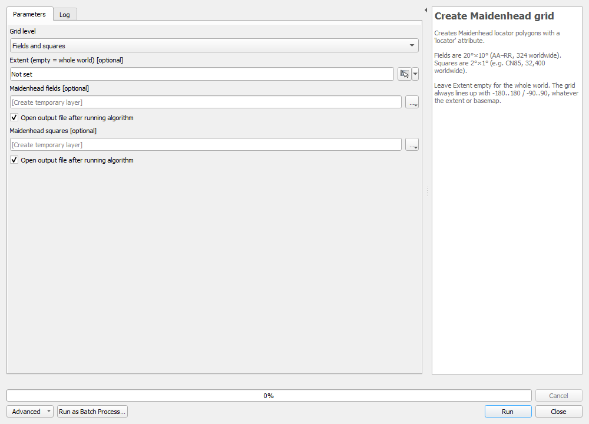
*The Create Maidenhead grid dialog. The defaults are fine.*

**You should see** two new layers, *Maidenhead fields* (324 cells, labelled `AA`–`RR`) and *Maidenhead squares* (32,400 cells). Zoom in over your area: squares and their labels (e.g. `FN31`) appear once you're closer than about 1:20,000,000.

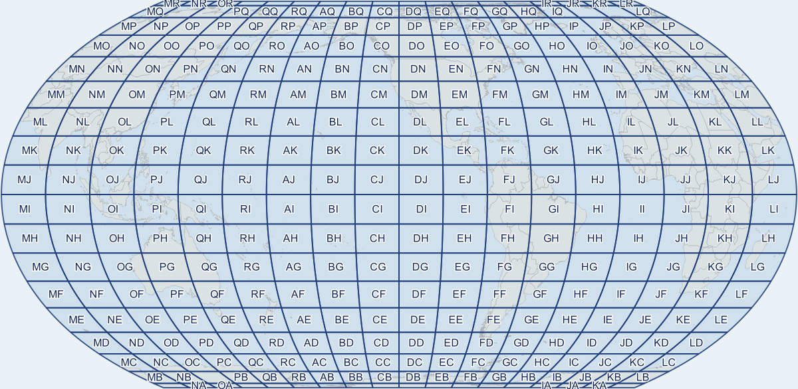
*Maidenhead fields in an Americas-centred Equal Earth projection.*

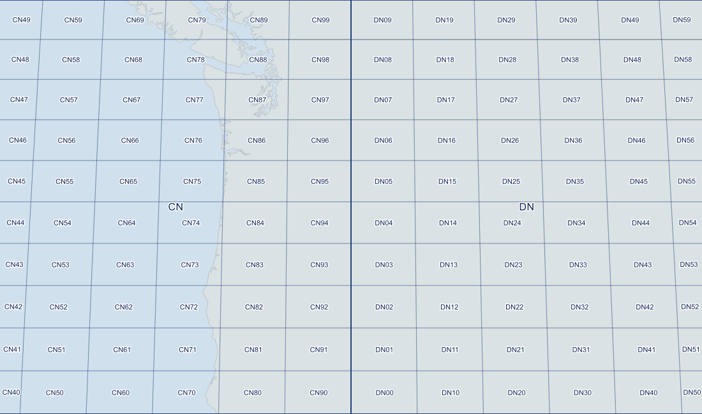
*Zoomed in, each field splits into 100 squares.*

### 1c. Centre the map on the Americas (optional)

The standard map splits the Pacific at its edges. For a station in the Americas, a map centred on your longitude keeps Asia on the left and Europe on the right, with paths across both oceans unbroken.

1. *Settings → Custom Projections…*, then click the green **+**.
2. **Name**: `Equal Earth, Americas centred`.
3. **Format**: *Proj String*.
4. **Parameters**:
   ```
   +proj=eqearth +lon_0=-120 +datum=WGS84 +units=m +no_defs
   ```
5. Click **Validate**, then **OK**.
6. *Project → Properties → CRS*. Type "Equal Earth" in the filter, pick yours under *User Defined Coordinate Systems*, and click **OK**.

**You should see** the world redrawn with the Americas in the middle. Equal Earth keeps areas true, so Europe and Japan don't look bigger than they are.

The world map in step 1b already uses this projection, with `-120`.

`-120` is about the US West Coast. Use a value near your own longitude: about `-100` for the central US, `-75` for the east coast, `0` for Europe, `140` for Japan or Australia. Your data isn't changed; only the drawing is.

---

## Step 2. Who hears me? PSK Reporter (10 minutes)

PSK Reporter collects reception reports from receivers worldwide. You'll download yours and map them.

### 2a. Fetch

1. Make a folder for the downloads, e.g. `Documents\PSK Reporter`.
2. *Plugins → Maidenhead Mapper → PSK Reporter → Fetch from PSK Reporter…*
3. **Callsign**: `N0CALL`. **Hours back**: `24`. **Save into folder**: your new folder.
4. Click **Run**.

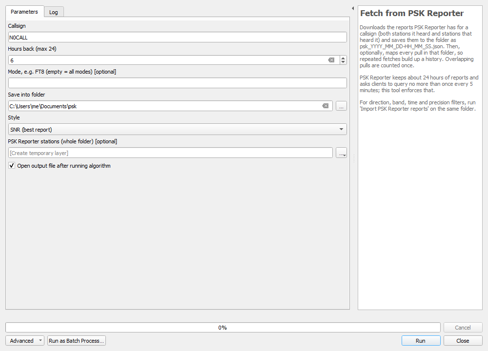
*The Fetch from PSK Reporter dialog.*

**You should see** a log line like *Saved 1,234 report(s) to …psk_2026_11_12-18_05_00.json*, and a layer *PSK Reporter stations* with one dot per station. The dots are coloured by best SNR: purple is weak, yellow is strong.

**Asking again within 5 minutes is refused.** PSK Reporter asks every client for that, and the tool tells you how long to wait. Fetch into the same folder every few hours to build a longer history; overlapping reports are counted once.

### 2b. Import with filters

1. *PSK Reporter → Import PSK Reporter reports…*
2. **Folder**: the same folder. **My callsign**: `N0CALL`. **My grid**: `FN31pr` (or leave it empty to use the grid PSK Reporter has for you).
3. **Direction**: *Stations that heard me*. **Style**: *Band*.
4. Click **Run**.

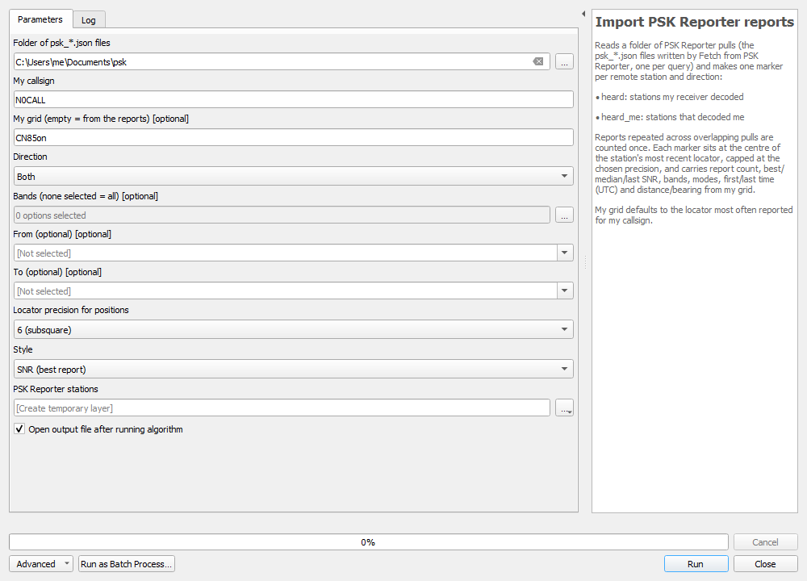
*The Import PSK Reporter reports dialog. Set **Direction** and **Style** further down.*

**You should see** only the stations that decoded **you**, coloured by band.

**What this tells you**: this is your transmit footprint. Gaps show where your signal doesn't reach. Compare it with *Stations I heard* (your receive footprint): if you hear much farther than you're heard, your receive side is relatively strong; the opposite suggests noise on your receive side.

Click a dot with the *Identify* tool (the "i" icon) to see its fields:

- `snr_best`, `snr_median`, `snr_last`;
- `bands`;
- `first_utc`, `last_utc`;
- `distance_km`, `bearing_deg`;
- `hops` and `takeoff_deg`, the fewest F2 hops and the takeoff angle they need.

To restyle, open *Layer Properties → Symbology*. Callsign labels appear when you zoom in.

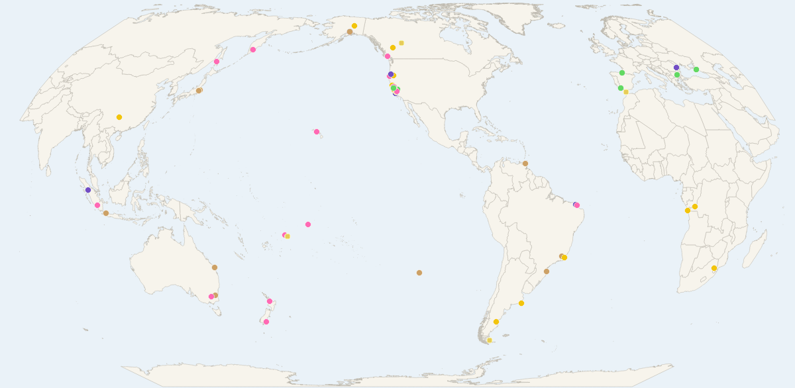
*70 of the stations one receiver reported in 6 hours, coloured by band.*

---

## Step 3. Map your WSJT-X history (10 minutes)

### 3a. ALL.TXT: every decode, including other people's QSOs

1. In WSJT-X, *File → Open log directory* shows where `ALL.TXT` is.
2. *Plugins → Maidenhead Mapper → WSJT-X → Import WSJT-X ALL.TXT…*
3. **ALL.TXT file(s)**: click **…** and add the file. **My callsign** and **My grid**: yours.
4. Optional: set **From** and **To** to an evening you operated, to keep it quick.
5. Click **Run**.

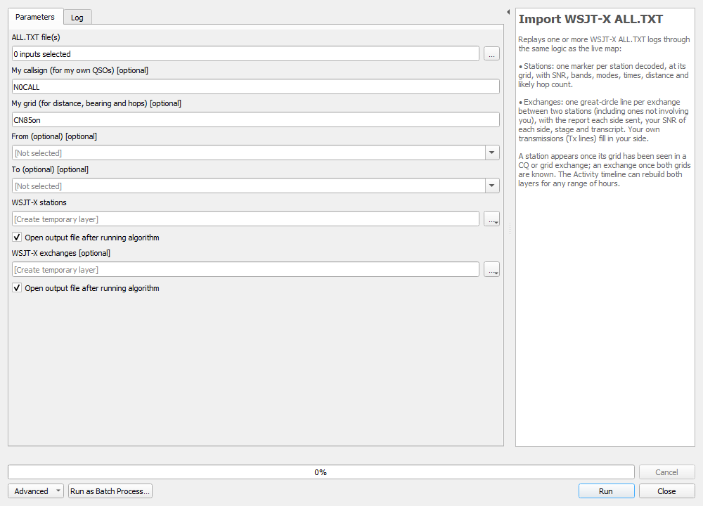
*The Import WSJT-X ALL.TXT dialog.*

**You should see** two layers:

- **WSJT-X stations (ALL.TXT)**: one dot per station decoded, coloured by best SNR. ALL.TXT doesn't record which QSOs you logged, so there are no "worked" stars here; step 3c adds those from your log.
- **WSJT-X exchanges (ALL.TXT)**: lines between pairs of stations that worked each other, **including QSOs that didn't involve you**.

The log reports how many stations were placed, and how many never sent a grid (those can't be drawn).

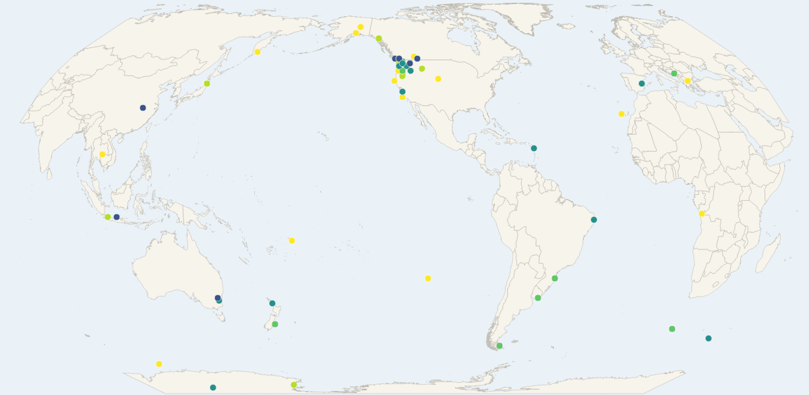
*The stations layer: 60 of the 1,351 stations decoded in one day, coloured by best SNR (purple weak, yellow strong).*

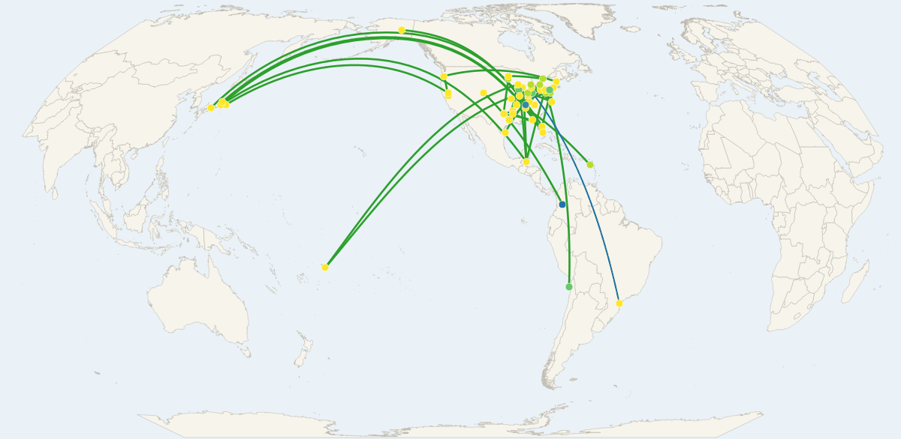
*The exchanges layer: 40 exchanges with both reports in one hour, mostly between other stations. Green = confirmed, blue = both reports.*

### 3b. Read the exchanges layer

FT8 reports say how the sender hears the addressee. When you decode both sides of someone else's QSO, you get the signal report **both ways**.

1. Zoom in until labels appear on the lines (past about 1:10,000,000). A label like `N5ER→AH6U +07  AH6U→N5ER -04` means:
   - N5ER's signal reached AH6U at +07 dB;
   - AH6U's reached N5ER at −04 dB.
2. Line style shows how far the exchange got:
   - solid green: confirmed;
   - solid blue: both reports;
   - dashed purple: one report;
   - dotted grey: started.
3. Open the attribute table (right-click → *Open Attribute Table*):
   - `a_hears_b` and `b_hears_a` are the two reports;
   - `me_hears_a` and `me_hears_b` are how **you** decoded each side;
   - `b_vs_me_db` is how B heard A minus how you heard A. Positive means B heard that signal better than you did.

**What this tells you**: every exchange you overhear is a small propagation measurement between two other places. It doesn't need your transmitter at all. A single exchange is noisy (FT8 reports fade by many dB); many exchanges tell a story. Step 7 uses them.

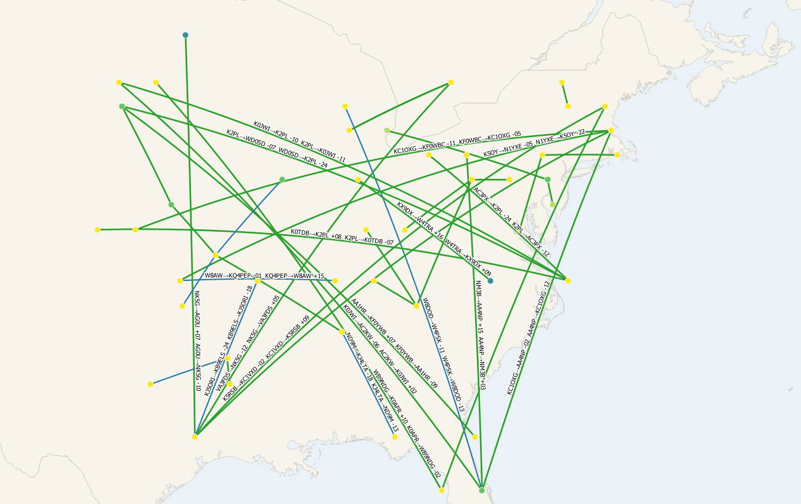
*40 exchanges with both reports between stations in the eastern US. Each label gives the SNR each way.*

### 3c. ADIF: your logged QSOs

1. *WSJT-X → Import ADIF log (.adi / .adx)…*
2. **ADIF file(s)**: `wsjtx_log.adi` from the same folder as `ALL.TXT`, and/or a log exported from your logger. If you have a LoTW download, add it too.
3. Click **Run**.

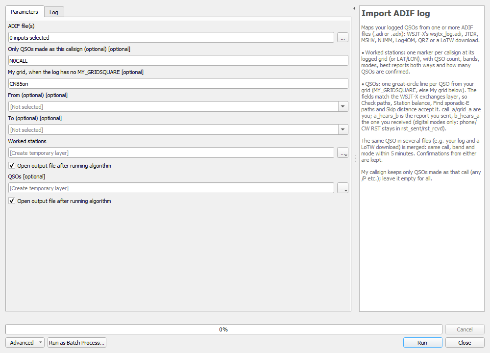
*The Import ADIF log dialog.*

**You should see**:

- **Worked stations (ADIF)**: one dot per callsign you've worked, coloured by band;
- **QSOs (ADIF)**: one line per QSO from your grid.

If you added LoTW, the log reports how many duplicates were merged, and `confirmed` shows which QSOs are confirmed.

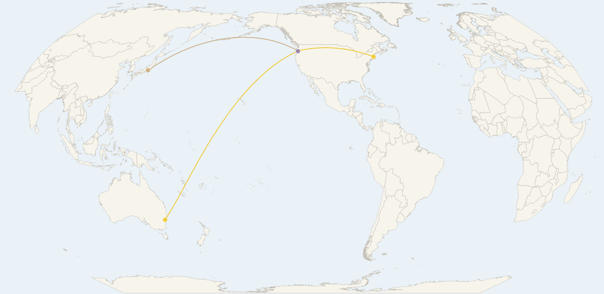
*A 4-QSO sample log, one QSO merged with its LoTW confirmation, coloured by band.*

**What this tells you**: your whole logging history on one map, not just the period `ALL.TXT` covers. A filter such as `"confirmed" IS NULL` (right-click → *Filter…*) shows QSOs still waiting for a confirmation.

---

## Step 4. Replay an evening with the Activity timeline (5 minutes)

1. *Plugins → Maidenhead Mapper → Activity timeline*. A panel opens under the map.
2. In its drop-down, choose your ALL.TXT import.

**You should see** bars of decodes per UTC hour: blue for all decodes, orange for decodes addressed to you.

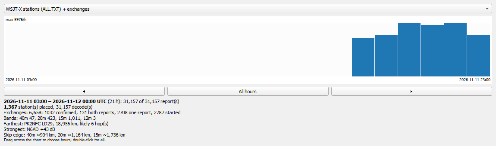
*The Activity timeline for one day's ALL.TXT import, with a few hours chosen.*

3. **Drag** across a few hours. The map changes as you drag: the stations and exchanges layers now show only those hours. Their counts and SNR describe just that window, and the layer names show the times.
4. Use **◀ ▶** to step the window through the evening. **All hours** brings everything back.

**What this tells you**: how the band opened and closed. Watch distant stations appear as the band opens, then the nearer ones drop out as the skip zone grows. Below the chart, the panel lists the farthest and strongest stations in the window, and the skip edge per band.

The same works for your PSK Reporter layers.

### 4b. Watch an evening as an animation

1. *WSJT-X → Propagation over time (ALL.TXT)*. A panel opens on the right, with your `ALL.TXT` already chosen.
2. Click **Index**. A chart of decodes per hour appears.
3. Drag across the chart to pick an evening. Keep **Group by** *Hour* and **Cell size** *Field*.
4. Click **Build time-slider layers**, then press **▶** in the Temporal Controller that opens.

**You should see** the corridors change hour by hour: which areas could work which, and where the activity was.

**What this tells you**: how openings move. In one November evening decoded on the US west coast (mostly 15m), paths to Europe had faded by 22:00 UTC while Japan and South America were open; later the Pacific and Australia took over.

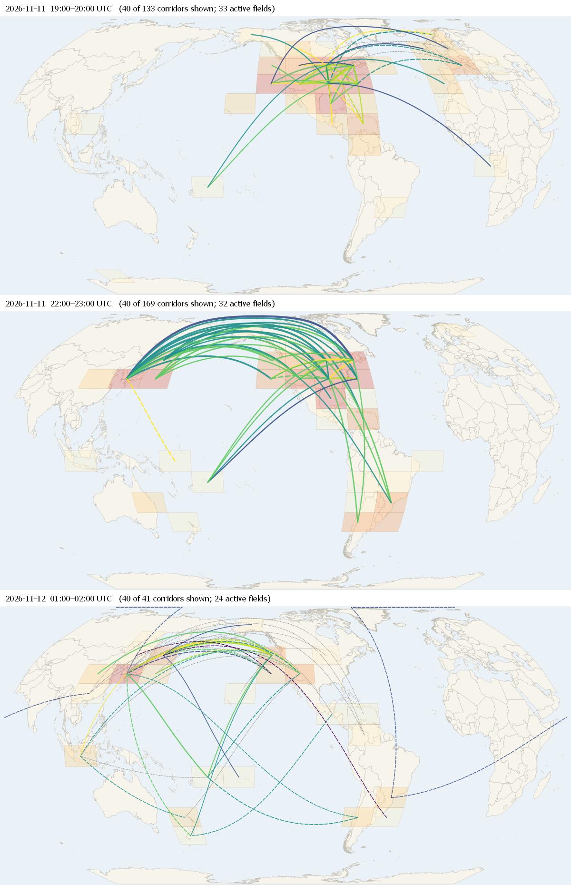
*Three frames from one evening: Europe, then Japan and South America, then the Pacific.*

---

## Step 5. The live map while you operate (5 minutes to set up)

### 5a. One-time WSJT-X setup

WSJT-X shares what it decodes over UDP. Use **multicast**, so QGIS, JTAlert, GridTracker and your logger can all listen at once.

1. In WSJT-X: *File → Settings → Reporting*.
   - **UDP Server**: `239.255.0.1`.
   - **UDP Server port number**: `2237`.
   - Under *Outgoing interfaces*, tick your network adapter(s) and loopback.
2. If you run JTAlert, GridTracker or a logger, set their WSJT-X UDP address to the same `239.255.0.1:2237`.

### 5b. Start the map

1. *Plugins → Maidenhead Mapper → WSJT-X → WSJT-X live map*. A panel opens on the right.
2. Keep *Multicast*, `239.255.0.1`, `2237`. Set **Fade over** to `30` min.
3. Tick **Save session to a GeoPackage in** and choose a **permanent** folder, e.g. `Documents\WSJT-X sessions`.
4. Click **Start**.

**You should see**:

- the status changes to *Listening*;
- after the next decode period, your WSJT-X instance appears with its frequency, band and grid;
- dots appear as stations are decoded, with lines for exchanges.

Stations fade over 30 minutes after they were last heard. When you log a QSO, that station becomes a red star.

**What this tells you**: who is on the band right now, and where. Faded dots show where the band *was* open. The status counts stations *waiting for a grid*: decoded, but not yet seen sending a grid.

With saving on, the session is written every 2 seconds to `wsjtx_session_YYYYMMDD_HHMMSS.gpkg`, so nothing is lost if QGIS closes. To look at it again later, drag its `stations` and `exchanges` tables from the `.gpkg` into any project; the timeline recognises it. The Activity timeline also offers **WSJT-X live map (running)**: choosing hours there shows the past while the map keeps recording.

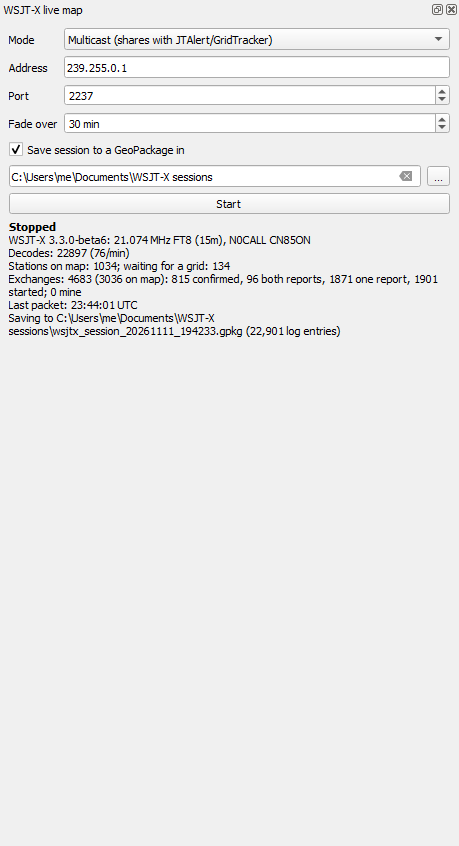
*The live map panel: instance, decode rate, stations, exchanges by stage and the session file.*

---

## Step 6. What was the ionosphere doing? (10 minutes)

### 6a. Fetch current conditions

1. *Plugins → Maidenhead Mapper → Ionosphere → Fetch ionosphere (KC2G)…*
2. **Contour map**: *MUF(3000)F2, MHz*. Click **Run**.

**You should see**:

- *Ionosondes*: points labelled with station codes, the radars that measure the ionosphere;
- contour lines of MUF(3000).

The MUF(3000) is the highest frequency a 3,000 km hop can use at that place. Where the contours are above 28 MHz, 10m is open for long hops from there.

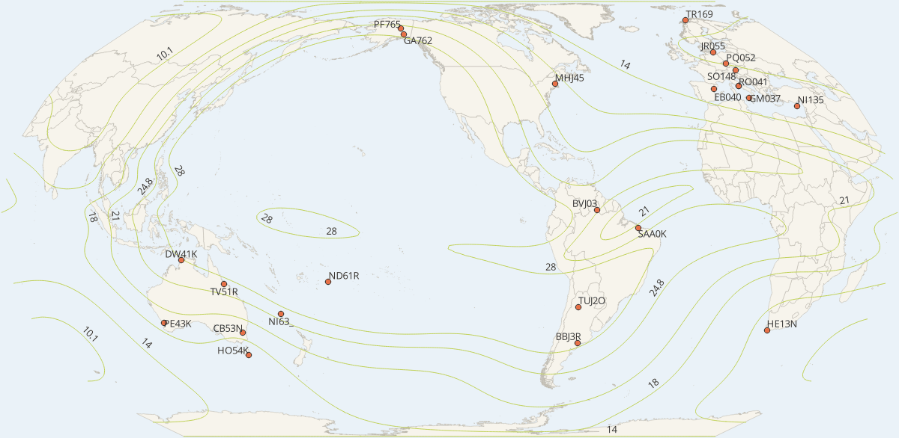
*KC2G ionosondes and MUF(3000)F2 contours in MHz.*

This is KC2G's **current** data only. There is no history.

### 6b. Check your paths

1. *Ionosphere → Check paths against the ionosphere (MUF)…*
2. **Station or exchange layer**: your live exchanges, or the ALL.TXT exchanges from step 3.
3. **Ionosphere source**: *Auto*. Recent paths use KC2G; older ones use the CCIR model, a monthly-median model that the first run downloads (about 0.5 MB).
4. Click **Run**.

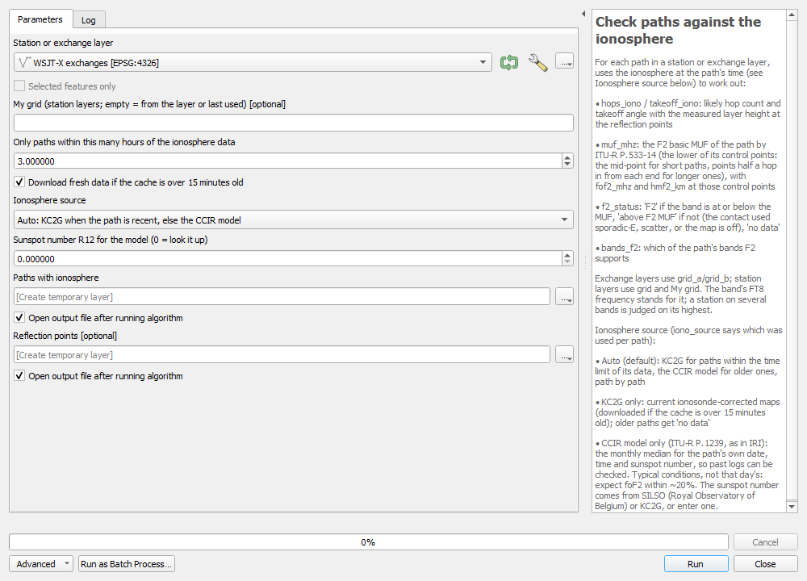
*The Check paths dialog.*

**You should see** a copy of the layer coloured by `f2_status`:

- **green, F2**: the band was at or below the path's MUF. Normal F2 propagation explains it.
- **red, above F2 MUF**: plain F2 hops don't explain it. It could be sporadic-E, scatter, an unusual path, or the ionosphere map being off.
- **grey, no data**: no ionosphere data for that time, or the path had no grid or band.

You also get a **reflection points** layer:

- grey dots where each hop meets the layer;
- diamonds where the MUF is judged (green if the band fits, red if not).

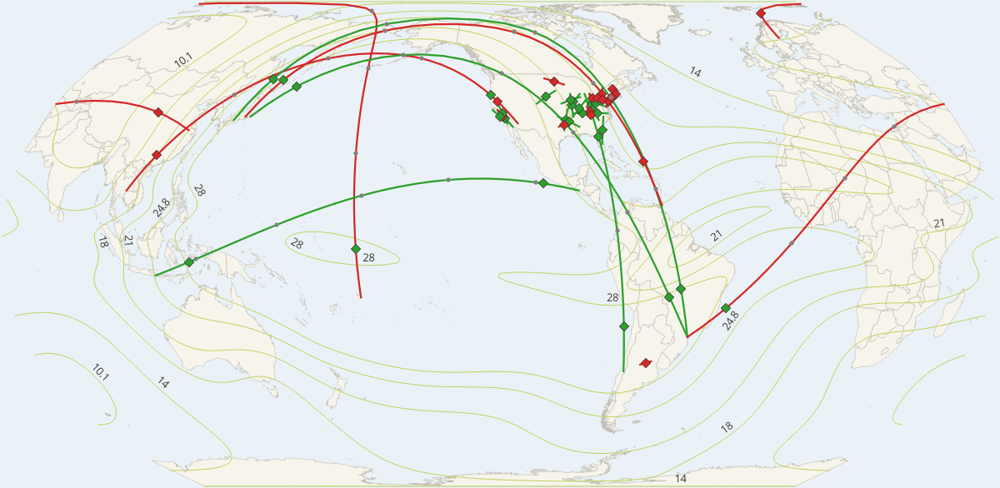
*20 paths the F2 layer supports (green) and 20 above the F2 MUF (red), with their reflection points over the MUF(3000) contours.*

**What this tells you**: `muf_mhz`, `hmf2_km`, `hops_iono` and `takeoff_iono` give each path's likely geometry. Be careful with the red paths:

- The MUF here is the *basic* MUF of ITU-R P.533. Real paths often work 10–20% above it, especially long ones.
- The CCIR model describes a typical day for that month, not the actual day.

So read red as "worth a look", not as proof.

### 6c. Look for sporadic-E

1. *Ionosphere → Find sporadic-E paths…*. Input: the same layer (or the output of 6b). Click **Run**.

**You should see** points at the midpoints of 500–2,300 km paths on 12m, 10m, 6m and up that F2 can't explain, and *clouds* grouping nearby ones.

**What this tells you**: sporadic-E is patchy ionisation about 105 km up, common in summer. The midpoints show roughly where the patch was. `foes_min_mhz` is the least intense the patch could have been to return that band at that range. It's a candidate, not a certainty; with the model alone, 10m results are "likely" rather than sure.

If nothing is found, that's normal outside the sporadic-E season or on lower bands.

### 6d. Skip distance by hour

1. *Ionosphere → Skip distance by hour…*
2. Input: a PSK Reporter layer, an ALL.TXT import, a live or saved session, or your ADIF QSOs. Click **Run**.

**You should see** a table, per band and UTC hour:

- `skip_km`, the skip edge: the 10th percentile of sky-wave distances, given 20 or more contacts in the hour;
- `median_km` and `p90_km`;
- three foF2 values for comparison: `fof2_est_mhz` (implied by the skip edge), `ccir_fof2_mhz` (model) and `kc2g_fof2_mhz` (when available).

**What this tells you**: the skip zone grows when the ionosphere weakens (evening on the high bands) and shrinks when it strengthens. `fof2_est_mhz` is an indicator for comparing hours, not a measurement.

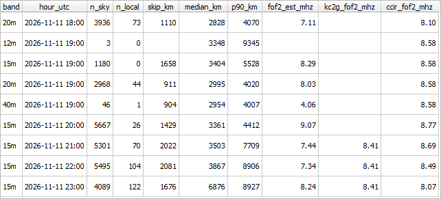
*Skip distance by hour for one day's ALL.TXT. An hour with fewer than 20 contacts gets no skip edge.*

---

## Step 7. Station balance and corridors (5 minutes, and lots of data)

1. *WSJT-X → Station balance from two-way reports…*
2. **Exchange layer(s)**: your live exchanges and/or ALL.TXT exchanges. You can add ADIF QSOs too. Keep **Separately per band** ticked.
3. Click **Run**.

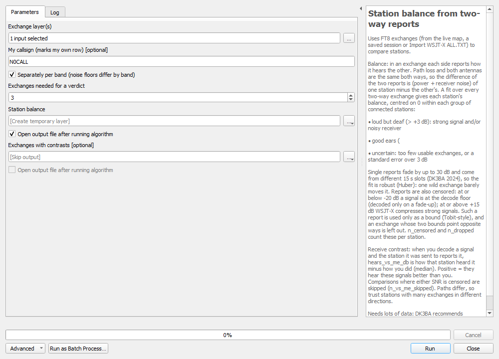
*The Station balance dialog.*

**You should see** stations coloured by **verdict**:

- red, *loud but deaf*: they're heard better than they hear;
- green, *balanced*;
- blue, *good ears*: they hear better than they're heard;
- grey, *uncertain*.

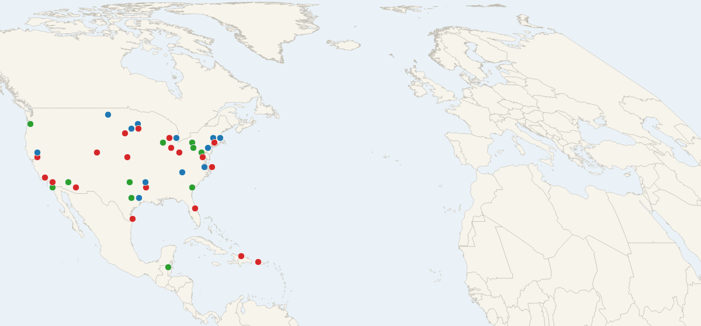
*The 60 stations with the most exchanges in one day's ALL.TXT. One day is far less data than recommended, so treat this as an illustration; with version 0.9.3 and later more of these come out *uncertain*.*

**What this tells you**: in an exchange, both directions share the same path and the same antennas. The difference between the two reports is therefore down to one station's power and receiver noise against the other's. A "loud but deaf" station probably runs high power, a noisy receive location, or both.

`hears_vs_me_db` compares how a station heard a signal with how **you** heard the same signal. Positive means they hear those signals better than you do. Your own row (`is_me = 1`) answers "am I loud but deaf?"

**How much data**: FT8 reports are noisy (they fade by up to 30 dB). You need **dozens to about 100 exchanges per station** for a trustworthy verdict, and an hour of decoding gives only a few per station. Expect mostly *uncertain* at first. Run the live map with saving on for days, then try again.

### 7b. Summarize into corridors

With thousands of exchanges, the lines are unreadable. Summarize them:

1. *WSJT-X → Summarize exchanges by grid pair…*
2. **Exchange layer(s)**: the same layers. **Cell size**: *Field (EM)*. Click **Run**.

**You should see** one line per pair of grid fields and band. Wider lines carry more exchanges; the colour is the median SNR. Zoomed in, a label such as `127×  -1/-2` gives the number of exchanges and the median SNR each way.

**What this tells you**: which paths were really open, how strong they were, and for how long (`hours_active`). Check `stations_a` and `stations_b`: a corridor with one station at one end is a single busy station, not an open path. Rerun with *2×2 squares* or *Square* to look at your region in more detail.

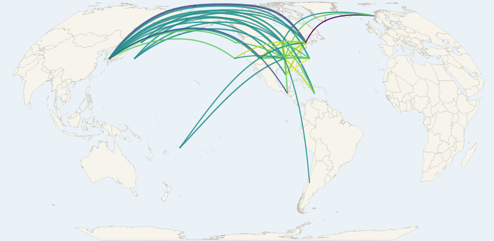
*The 40 busiest field corridors from one evening's live map. Most traffic ran between the US and Japan.*

---

## Step 8 (optional). Compare two antennas

If you have two antennas, you can compare them with no test equipment.

1. Run **two WSJT-X instances** on the same band at the same time, one per antenna and receiver. Start the second with `wsjtx --rig-name=B`.
2. Either let each write its own `ALL.TXT`, or send both to the live map with session saving on.
3. Leave them running: a few hours at least, ideally day and night.
4. *WSJT-X → Antenna A/B comparison…*. Give receiver A's and B's `ALL.TXT` files, or the session layer. Click **Run**.

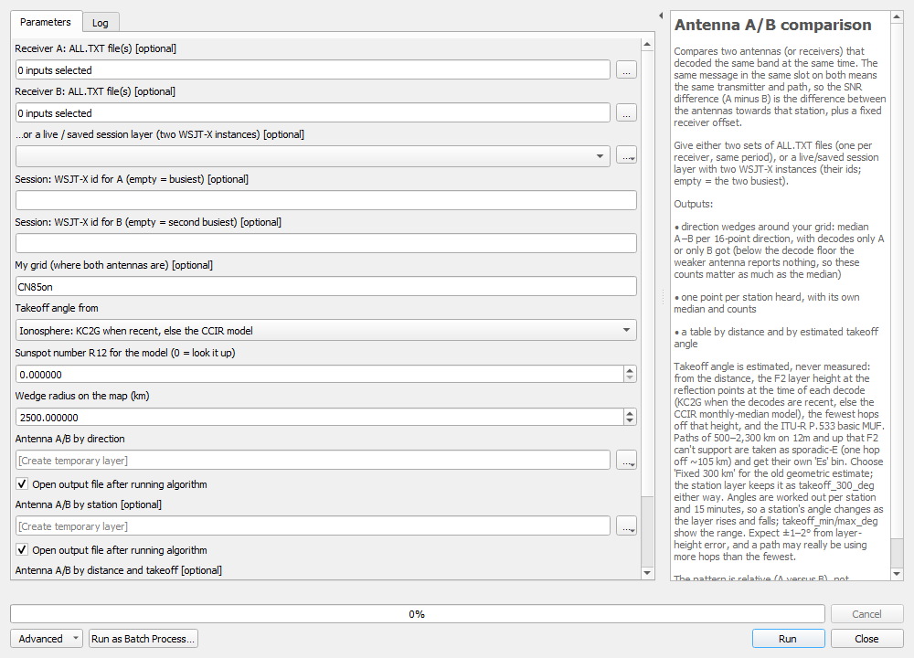
*The Antenna A/B comparison dialog.*

**You should see** 16 wedges around your grid:

- green where antenna A is stronger, purple where B is;
- each labelled with the median difference, the number of pairs, and `+only A/only B` decodes.

A table breaks the results down by distance and by takeoff angle.

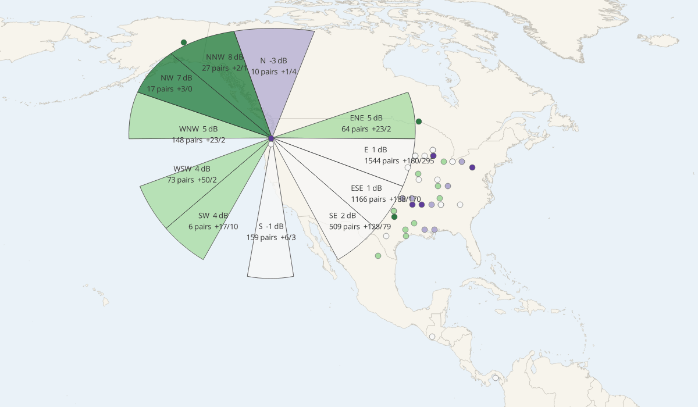
*A vertical (A) against a loop (B), from about 75 minutes of recordings.*

**What this tells you**: when both receivers decode the same message in the same slot, everything but the antennas (and a fixed receiver offset) is identical. The wedges are therefore a **relative** pattern by direction.

- Read the `only A / only B` counts as well as the median. A weaker antenna often doesn't decode at all rather than decoding weakly.
- Takeoff angles are **estimates**, from the layer height at the time and the fewest hops; expect ±1–2° and occasional wrong hop counts.
- Trust bins with about 100 pairs or more.

---

## Step 9. Where next

- **Keep the live map running with saving on.** Station balance, skip distance and the antenna comparison all improve with days of data.
- **Fetch PSK Reporter regularly** into the same folder to build a long history. The timeline then shows openings over days.
- **Combine layers**: run *Check paths* on your ADIF QSOs to see which of your contacts needed sporadic-E.
- **Make maps to share**: *Project → New Print Layout* adds a title, legend and scale bar. Export to PDF or PNG.
- **Read the [user guide](user-guide.md)** for every setting and field, and for troubleshooting.
