# Maidenhead Mapper user guide

Maidenhead Mapper is a QGIS plugin for amateur radio. It draws the Maidenhead locator grid and maps where your signals go and come from, using PSK Reporter, WSJT-X (live or from logs) and ADIF logs. It also checks paths against the ionosphere.

This guide is the reference: what every tool does, its settings, and what its output fields mean. For a guided first hour, see the [tutorial](tutorial.md).

**Contents**

1. [Before you start](#1-before-you-start)
2. [Install](#2-install)
3. [Where everything is](#3-where-everything-is)
4. [Words used in this guide](#4-words-used-in-this-guide)
5. [Grid: Create Maidenhead grid](#5-grid-create-maidenhead-grid)
6. [PSK Reporter](#6-psk-reporter)
7. [WSJT-X](#7-wsjt-x)
8. [Ionosphere](#8-ionosphere)
9. [Activity timeline](#9-activity-timeline)
10. [Field reference](#10-field-reference)
11. [Data files, caches and settings](#11-data-files-caches-and-settings)
12. [Troubleshooting](#12-troubleshooting)
13. [Credits and licences](#13-credits-and-licences)

---

## 1. Before you start

- **QGIS 3.34 or later.** Tested on QGIS 3.44 on Windows.
- **No extra Python packages.** The plugin uses only QGIS and the Python standard library.
- **Internet**, only for PSK Reporter, KC2G and the one-time downloads of the ionosphere model data. Everything else works offline.
- All times in the plugin are **UTC**.

A few QGIS basics help:

- The **Layers panel** lists your layers. Untick a layer to hide it. Right-click → *Open Attribute Table* shows its data.
- **Processing tools** open a dialog with settings, then a log as they run. The log tells you what was read, skipped and found. Read it when a result looks wrong.
- Most outputs are **temporary layers** (a small icon next to the name). They disappear when you close QGIS unless you right-click → *Make Permanent* or choose a file in the tool's output box.

## 2. Install

### From a zip (most users)

1. Get `maidenhead_mapper-<version>.zip`. To build it from the source code, run `python tools/package.py`; the zip appears in `dist/`.
2. In QGIS: *Plugins → Manage and Install Plugins → Install from ZIP*, pick the zip, and click *Install Plugin*.
3. Check that **Maidenhead Mapper** is ticked under *Installed*.

### For development (Windows)

Link the source folder into your QGIS profile so QGIS runs the code you edit. In `cmd`:

```
mklink /J "%APPDATA%\QGIS\QGIS3\profiles\default\python\plugins\maidenhead_mapper" "<path to the repository>\maidenhead_mapper"
```

Restart QGIS and enable the plugin. The **Plugin Reloader** plugin picks up code changes without a restart.

### Your callsign and grid

The plugin remembers your callsign and grid between tools. The first tool you run that asks for them stores them; later tools fill them in for you. You can always type a different value for one run.

## 3. Where everything is

Everything is under *Plugins → Maidenhead Mapper*, and under the Maidenhead Mapper toolbar button's drop-down. It is grouped by purpose:

| Menu section | Entries |
|---|---|
| Grid | Create Maidenhead grid… |
| PSK Reporter | Fetch from PSK Reporter…, Import PSK Reporter reports… |
| WSJT-X | WSJT-X live map (panel), Import WSJT-X ALL.TXT…, Import ADIF log (.adi / .adx)…, Summarize exchanges by grid pair…, Propagation over time (panel), Station balance from two-way reports…, Antenna A/B comparison…, Export research dataset… |
| Ionosphere | Fetch ionosphere (KC2G)…, Check paths against the ionosphere (MUF)…, Predict paths with VOACAP…, Find sporadic-E paths…, Skip distance by hour… |
| (top level) | Activity timeline (panel) |

The ionosphere tools work on any station or exchange layer, from any source. They are not part of the live map.

Every tool is also in the **Processing Toolbox** (*Processing → Toolbox*) under *Maidenhead Mapper*. From there you can run them in batch mode or use them in models.

## 4. Words used in this guide

| Term | Meaning |
|---|---|
| **Field / square / subsquare** | Maidenhead locator levels: 2 characters (20° × 10°, e.g. `CN`), 4 characters (2° × 1°, e.g. `CN85`), 6 characters (e.g. `CN85pm`). FT8 sends 4-character squares. |
| **Station layer** | Points, one per station (and direction), at the centre of its grid. Has a `grid` field. A path runs from *your* grid to the station. |
| **Exchange layer** | Lines, one per exchange or QSO between two stations. Has `grid_a` and `grid_b`. A path runs from A to B. |
| **SNR / report** | Signal-to-noise ratio in dB, as WSJT-X reports it. In FT8 a report says how the **sender** hears the **addressee**. |
| **F2 layer** | The highest, densest layer of the ionosphere, roughly 200–400 km up. It carries most long-distance HF contacts. |
| **foF2** | The F2 layer's critical frequency: the highest frequency it reflects straight back down. Higher foF2 means more bands open. |
| **hmF2** | The height of the F2 layer's peak, in km. It sets how far one hop reaches and at what angle. |
| **MUF** | Maximum usable frequency for a path. Signals above it pass through the layer and are lost. A band works by F2 only if its frequency is at or below the path's MUF. |
| **MUF(3000)** | The MUF for a 3,000 km hop at one place; what ionosonde maps show. |
| **Hop** | One trip up to the layer and back down. Long paths use several hops. |
| **Takeoff angle** | How far above the horizon the signal leaves (and arrives at) the antenna. Long single hops need low angles (a few degrees); more hops or short paths need higher angles. |
| **Sporadic-E (Es)** | Patches of dense ionisation at about 105 km that come and go, mostly in summer. They open 10m and 6m over 500–2,300 km when F2 can't. |
| **Skip zone** | The ring around you too far for ground wave but too close for sky wave. Its outer edge is the *skip distance*. |
| **Ionosonde** | A radar that measures foF2, hmF2 and MUF directly above it. |
| **Corridor** | All the exchanges between two grid cells (on one band, or in one time frame), drawn as one line with medians of the reports each way. |
| **Frame** | One step of an animation: an hour, 3 hours or a day. A time-enabled layer shows only the features of the current frame. |
| **Temporal Controller** | QGIS's built-in time slider (*View → Panels → Temporal Controller*). It plays time-enabled layers frame by frame. |
| **Research export** | A table with one row per observed SNR (who transmitted, who received, when, on which band, and the path), for merging with other operators' data and for propagation research. See [7.8](#78-export-research-dataset). |
| **Censored** | A value known only to be at or below a limit. FT8 reports stop near −24 dB, so a report there may stand for a weaker signal. A `not_decoded` row is censored with no value at all. |
| **Basic vs operational MUF** | The basic MUF is what the ionosphere model gives (ITU-R P.1239 / CCIR, by P.533's rules); it is what *Check paths* and the research export use. P.533's operational MUF adds an allowance that makes it a bit higher, so a path a little above the basic MUF can still be F2. |
| **f/MUF** | The frequency divided by the path's MUF. Up to 1: F2 can carry it; over 1: something else is needed (sporadic-E, scatter) or the ionosphere was better than the model. |
| **Sunspot number (R12)** | The 12-month smoothed sunspot number. The CCIR model uses it to scale the ionosphere to the solar cycle. |
| **VOACAP** | The standard HF prediction program from NTIA/ITS. It predicts a path's MUF, mode, SNR and reliability for a month, hour and sunspot number. You install it yourself; see [8.5](#85-predict-paths-with-voacap). |
| **REL** | VOACAP's reliability: the share of the month's days on which the SNR reaches the required SNR (for FT8, about −21 dB). |

## 5. Grid: Create Maidenhead grid

Draws the locator grid as polygon layers with a `locator` label.

**Settings**

| Setting | Default | Notes |
|---|---|---|
| Grid level | Fields and squares | *Fields (2-char)*, *Squares (4-char)* or both. |
| Extent (empty = whole world) | empty | Limit to the map view or a layer's extent. Any CRS works; cells still line up with whole degrees. |
| Maidenhead fields / Maidenhead squares | temporary layers | Untick one to skip it, or save to a file. |

**Output**: 324 fields and 32,400 squares for the whole world. Fields: `locator`, `field`, `level` (2 or 4). The layers come styled and labelled. Squares appear only when zoomed in past 1:20,000,000, and their labels past 1:15,000,000, so the world view stays readable.

The grid always spans exactly −180 to 180 and −90 to 90, whatever basemap or projection you use. Cell edges have a point every degree, so they follow the curved meridians and parallels of other projections. The east and west edges sit a hair (0.000001°, about 0.1 m) inside each cell, so a field boundary that falls exactly on a projection's seam, like 60°E on a map centred on 120°W, stays on its own side of the map. The `locator` values are unchanged. Grids made before version 0.9.3 have 4-corner cells: make a new one if the outer cells of an Americas- or Pacific-centred map look wrong.

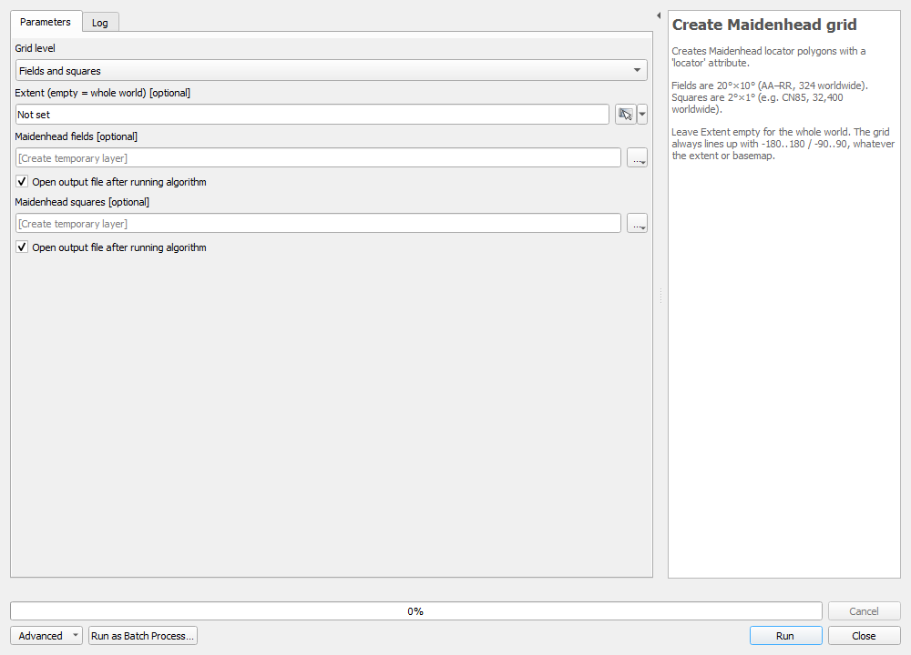
*The Create Maidenhead grid dialog.*

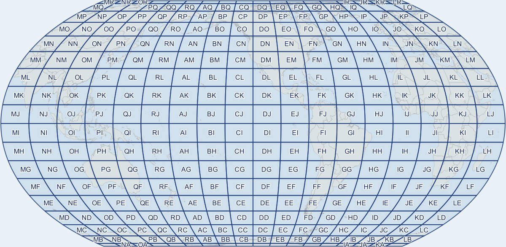
*Maidenhead fields in an Americas-centred Equal Earth projection.*

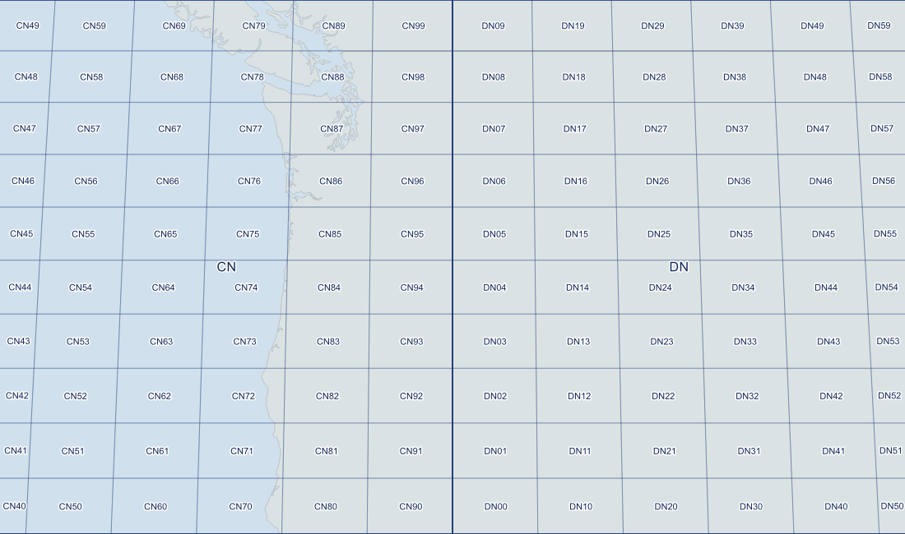
*Squares around the Pacific Northwest: fields CN and DN, each split into 100 squares.*

## 6. PSK Reporter

[PSK Reporter](https://pskreporter.info) collects reception reports from receivers worldwide. For your callsign it has two kinds:

- **heard**: stations *your* receiver decoded and reported;
- **heard_me**: stations that decoded *you*.

### 6.1 Fetch from PSK Reporter

Downloads the reports PSK Reporter has for a callsign and saves them to a folder, then maps the whole folder.

| Setting | Default | Notes |
|---|---|---|
| Callsign | your stored callsign | |
| Hours back (max 24) | 24 | PSK Reporter keeps about a day. |
| Mode, e.g. FT8 | empty (all modes) | |
| Save into folder | last folder used | Each fetch adds a file `psk_YYYY_MM_DD-HH_MM_SS.json` (UTC). |
| Style | SNR (best report) | See [6.3](#63-station-styles). |
| PSK Reporter stations (whole folder) | temporary layer | Untick to only download. |

**Limits**

- PSK Reporter asks clients to query **no more than once every 5 minutes**. The tool refuses earlier attempts and tells you how long to wait. A failed attempt counts too.
- There is no history beyond about 24 hours. To build one, fetch into the **same folder** every few hours. Reports repeated across overlapping fetches are counted once.

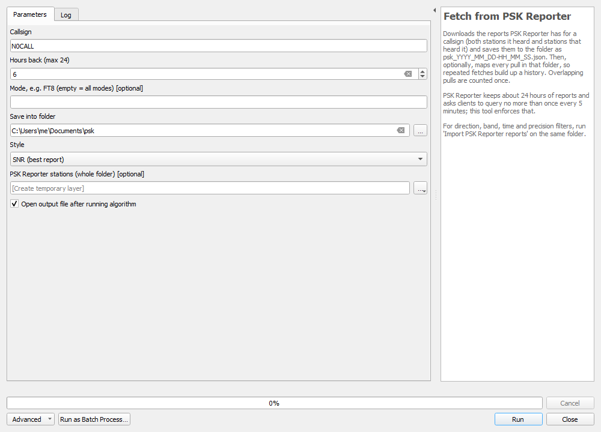
*The Fetch from PSK Reporter dialog.*

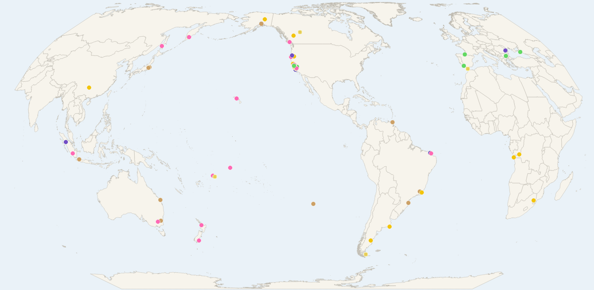
*70 of the 1,499 stations one receiver (KFS) reported in 6 hours, spread across directions, coloured by band. These spots carry no SNR, so the SNR style would leave them uncoloured; use the band style for such data.*

### 6.2 Import PSK Reporter reports

Maps a folder of `psk_*.json` files with filters. The output is a station layer: one point per remote station **and direction**, at the centre of its most recent locator.

| Setting | Default | Notes |
|---|---|---|
| Folder of psk_*.json files | | Empty or corrupt files are listed in the log and skipped. |
| My callsign | stored callsign | Portable forms (`N0CALL/P`) count as you. |
| My grid (empty = from the reports) | empty | Used for distance and bearing. Empty uses the locator most often reported for you. |
| Direction | Both | *Both*, *Stations I heard*, *Stations that heard me*. |
| Bands (none selected = all) | all | |
| From / To | empty | Optional UTC time limits. |
| Locator precision for positions | 6 (subsquare) | Caps how precisely markers are placed: 2, 4, 6, 8 or 10 characters. |
| Style | SNR (best report) | |

Fields: see [station layers](#101-station-layers). Reports without a usable locator are counted in the log, not silently dropped.

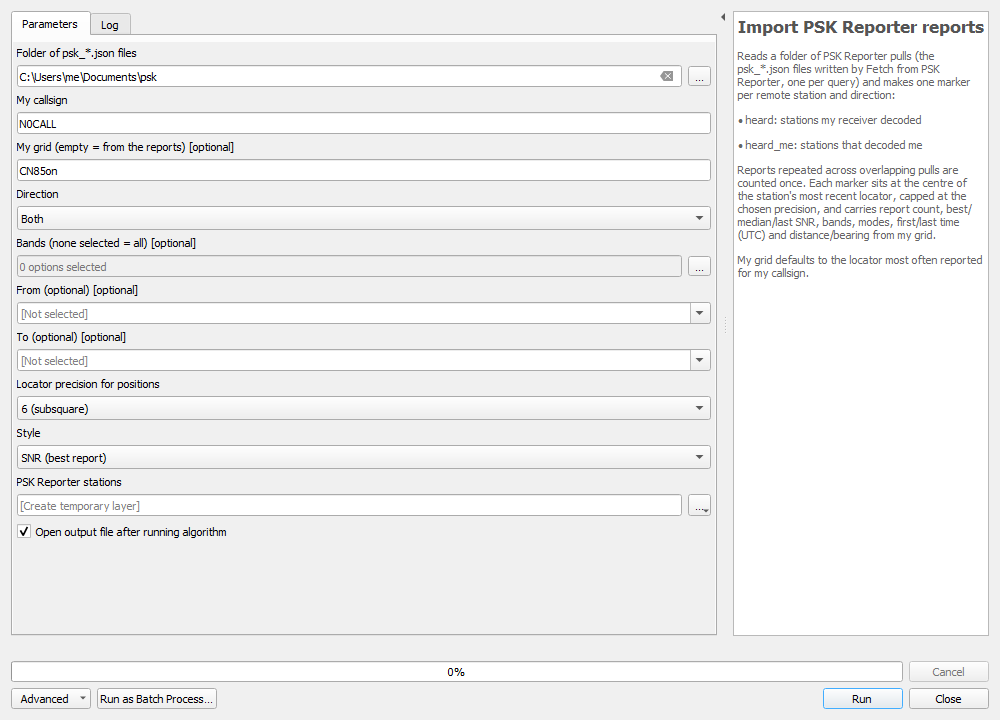
*The Import PSK Reporter reports dialog.*

### 6.3 Station styles

Station layers from the PSK Reporter tools can be styled four ways. Restyle any time in *Layer Properties → Symbology*.

- **SNR (best report)**: colour by `snr_best`, from dark purple (≤ −20 dB) to yellow (> 0 dB).
- **Band**: colour by the lowest band heard, using colours close to PSK Reporter's and GridTracker's.
- **Direction**: blue circles = I heard them; orange triangles = they heard me.
- **None**: a single symbol.

Callsign labels appear when zoomed in past 1:3,000,000.

## 7. WSJT-X

### 7.1 WSJT-X live map

*WSJT-X → WSJT-X live map* opens a panel on the right. It listens to the UDP messages WSJT-X sends and plots every station WSJT-X decodes, as it happens.

#### One-time setup

WSJT-X sends UDP messages to one address. **Multicast** lets several programs (QGIS, JTAlert, GridTracker, your logger) all receive them. Use it if you run anything else that listens to WSJT-X.

1. **WSJT-X**: *File → Settings → Reporting*. Set **UDP Server** to `239.255.0.1` and **UDP Server port number** to `2237`. Under *Outgoing interfaces*, tick your network interface(s), including loopback.
2. **JTAlert, GridTracker or your logger**: change their WSJT-X UDP setting to the same address and port.
3. **QGIS panel**: keep *Multicast*, `239.255.0.1`, port `2237`.

With only WSJT-X and QGIS, *Unicast* on `127.0.0.1:2237` (the WSJT-X default) also works, but then no other program can receive WSJT-X's messages.

#### Panel settings

| Setting | Default | Notes |
|---|---|---|
| Mode | Multicast | Switching mode swaps the standard address (`239.255.0.1` ↔ `127.0.0.1`). |
| Address, Port | `239.255.0.1`, `2237` | |
| Fade over | 30 min | Markers fade from full colour to 15% over this time since a station was last heard. Changes apply at once. |
| Save session to a GeoPackage in | off | Tick it and choose a folder **before** pressing Start. See below. |

Press **Start**. The status area shows:

- each WSJT-X instance heard, with its dial frequency, mode, band, callsign and grid;
- decodes in total and per minute;
- stations on the map, and stations *waiting for a grid*;
- exchanges by stage;
- the session file, if saving.

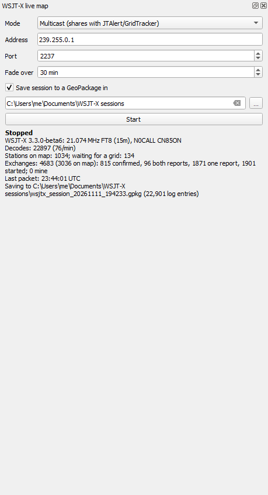
*The live map panel after a session: the WSJT-X instance, decode rate, stations, exchanges by stage and the session file.*

#### What you see

**Stations** (layer *WSJT-X live*):

- One marker per station heard, at the centre of its grid. FT8 and FT4 send 4-character grids, in CQs and when answering. A station seen only in messages without a grid is remembered, and placed once a grid turns up.
- Colour shows the best SNR. Markers fade with time since last heard.
- **Logging a QSO** in WSJT-X adds a red star for that station. Stars never fade.
- `called_me` counts messages from that station addressed to your call.

**Exchanges** (layer *WSJT-X exchanges*): one great-circle line per exchange between **any** two stations you can decode, not just your own QSOs. FT8 reports say how the sender hears the addressee, so a complete exchange gives the SNR both ways. Your own decodes add how *you* hear each side:

```
AH6U N5ER EM34     N5ER answers AH6U                 (you hear N5ER -12)
N5ER AH6U +07      AH6U hears N5ER at +07            (you hear AH6U -13)
AH6U N5ER R-04     N5ER hears AH6U at -04
N5ER AH6U RR73     signed off: confirmed
```

Each exchange has a **stage**, shown by line style:

| Stage | Meaning | Line |
|---|---|---|
| confirmed | both reports and a sign-off (RRR/RR73/73) | solid green |
| both reports | each side has reported the other | solid blue |
| one report | one side has reported | dashed purple |
| started | a call, no report yet | dotted grey |

- Messages between the same pair on the same band within 3 minutes belong to one exchange.
- A line is drawn once both grids are known. Some exchanges wait for a grid.
- The label (shown when zoomed in past 1:10,000,000) reads like `N5ER→AH6U +07  AH6U→N5ER -04`: signal from → to, arrived at that SNR.
- Your own QSOs are included. Your side comes from WSJT-X's status and *QSO Logged* messages, because your own transmissions aren't decoded. Filter on `involves_me = 1` to see only yours.
- Lines fade like markers; your logged QSOs don't.

Every station and exchange also gets `hops` and `takeoff_deg`: the fewest F2 hops (layer at 300 km, takeoff angle at least 2°) that cover the distance, and the angle that needs. This is geometry only. *Check paths* (section [8.2](#82-check-paths-against-the-ionosphere)) uses the real layer height.

#### Saving sessions

With *Save session to a GeoPackage* ticked, Start creates `wsjtx_session_YYYYMMDD_HHMMSS.gpkg` (UTC) in the chosen folder. It holds:

- `stations`: the station markers;
- `exchanges`: the exchange lines;
- `log`: every WSJT-X message the map used.

It is written every 2 seconds. The layers on the map **are** the file's tables, so nothing is lost if QGIS closes. Stopping and starting again with the same folder keeps writing the same file; choosing a different folder starts a new one.

- **Choose a permanent folder**, such as `Documents\WSJT-X sessions`. Don't use a temporary folder: Windows or a cleaner may empty it.
- The `log` table is what lets the [Activity timeline](#9-activity-timeline), *Skip distance* and *Antenna A/B comparison* replay any hours later.
- To reopen a session later, drag its `stations` and `exchanges` tables from the `.gpkg` into any project (or use *Layer → Add Layer → Add Vector Layer*). The plugin recognises a session file from its tables, so it doesn't matter which project it was recorded in.

Without saving, the layers are temporary. Right-click → *Make Permanent* keeps the current state but not the log. If you delete a live layer while it runs, it is rebuilt on the next update.

#### Testing without a radio

`tools/replay_alltxt.py` (in the source code) plays a recorded `ALL.TXT` as if WSJT-X were running:

```
python tools/replay_alltxt.py path\to\ALL.TXT --speed 30 --de-call N0CALL --de-grid FN31
```

- `--speed 0` sends as fast as possible.
- `--address 127.0.0.1` sends unicast.
- `--qso K1ABC:FN42` logs a QSO at the end.
- `--limit N` stops after N decodes.

### 7.2 Import WSJT-X ALL.TXT

Maps past sessions from WSJT-X's `ALL.TXT` (WSJT-X 2.1 or later; find it with *File → Open log directory* in WSJT-X). It runs the log through the same logic as the live map, so you get the same two layers.

| Setting | Default | Notes |
|---|---|---|
| ALL.TXT file(s) | | One or more files. Don't mix logs from two receivers covering the same time: everything would count twice. |
| My callsign (for my own QSOs) | stored callsign | Marks your QSOs. `Tx` lines in the log fill in your side. |
| My grid (for distance, bearing and hops) | stored grid | |
| From / To | empty | Optional UTC limits. |

**Outputs**: *WSJT-X stations (ALL.TXT)* and *WSJT-X exchanges (ALL.TXT)*, with the same fields and colours as the live map, without fading. The Activity timeline can rebuild both for any hours.

ALL.TXT has no record of which QSOs you actually logged. Use the ADIF import for that.

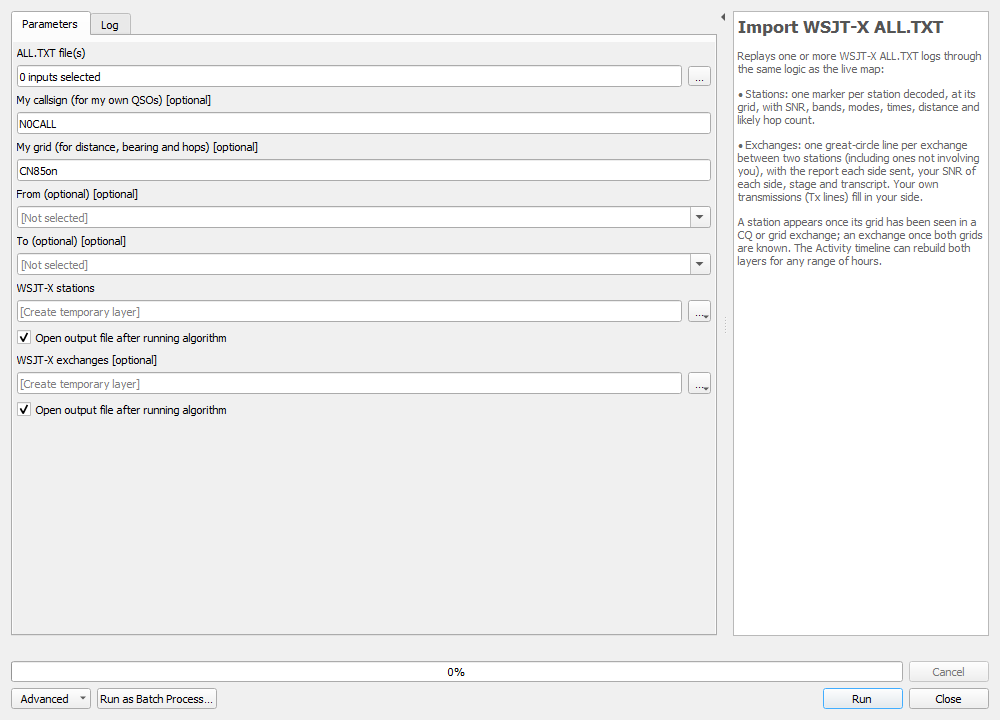
*The Import WSJT-X ALL.TXT dialog.*

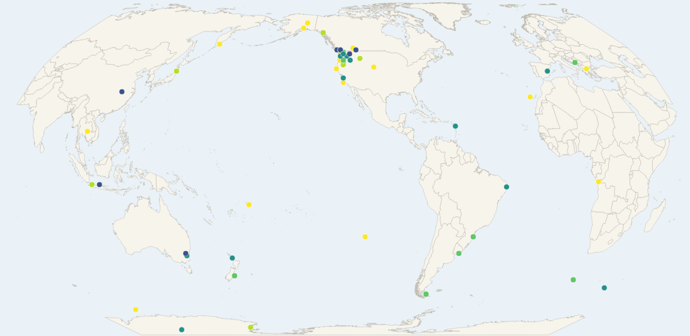
*Stations: 60 of the 1,351 stations decoded in one day, spread across directions and distances, coloured by best SNR (purple weak, yellow strong).*

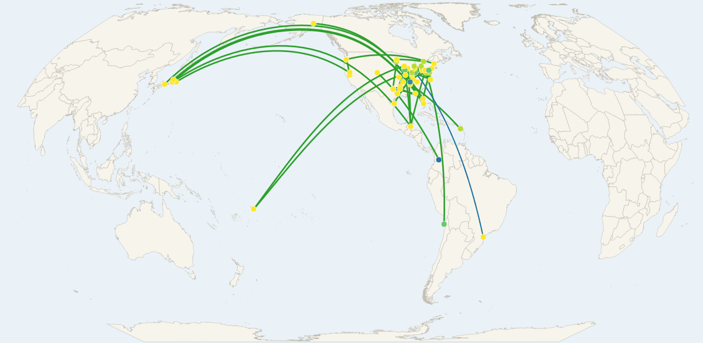
*Exchanges: 40 exchanges with both reports, 21:00–22:00 UTC, spread across directions, with their stations. Green = confirmed, blue = both reports.*

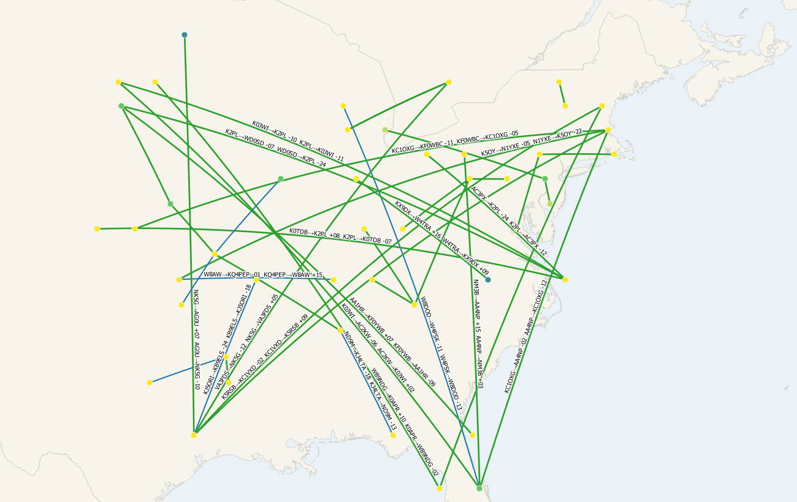
*Zoomed in: 40 exchanges with both reports between stations in the eastern US (one day). A label such as `KB1GTG→KZ9S +13  KZ9S→KB1GTG +14` gives the SNR each way.*

### 7.3 Import ADIF log (.adi / .adx)

Maps your logged QSOs from ADIF files: WSJT-X's `wsjtx_log.adi` (next to `ALL.TXT`), JTDX, MSHV, N1MM, Log4OM, QRZ, or a LoTW download. Both `.adi` and the XML `.adx` format work.

| Setting | Default | Notes |
|---|---|---|
| ADIF file(s) | | Several files are combined. |
| Only QSOs made as this callsign (optional) | stored callsign | For logs holding several of your calls; `/P` etc. count as the same call. Empty keeps everything. |
| My grid, when the log has no MY_GRIDSQUARE | stored grid | |
| From / To | empty | Optional UTC limits on the QSO start time. |

**How it reads the log**

- **Their location**: `GRIDSQUARE` (with `GRIDSQUARE_EXT`), else the first of `VUCC_GRIDS`, else `LAT`/`LON`. QSOs without any are counted in the log.
- **Your location**: each QSO's `MY_GRIDSQUARE`, else *My grid*. If you operated from several grids, lines start at each QSO's own grid; station distances use your most common grid.
- **Mode**: `SUBMODE` if present (FT4 is logged as `MODE=MFSK`, `SUBMODE=FT4`), else `MODE`.
- **Reports**: `RST_SENT` is how you heard them; `RST_RCVD` is how they heard you. For digital modes (FT8, FT4, JT65, JT9, Q65, MSK144, FST4, JS8, WSPR…) these are SNR in dB and become numbers. Phone and CW RST like `59` stay as text only.
- **Duplicates**: the same QSO in several files (same call and band, same mode when both have one, start times within 5 minutes) is merged. Blank fields are filled from the other copy, a longer grid wins, and confirmations from both are kept. Importing your log together with a LoTW download therefore marks confirmed QSOs.
- **Confirmed** means `QSL_RCVD`, `LOTW_QSL_RCVD` or `EQSL_QSL_RCVD` is `Y` or `V`.

**Outputs**

- **Worked stations (ADIF)**: one point per callsign, coloured by band. See [fields](#103-adif-layers).
- **QSOs (ADIF)**: one great-circle line per QSO, coloured by band. These lines have the **same fields as an exchange layer**, plus a few ADIF ones. You are `call_a`, so `a_hears_b` is the report you sent and `b_hears_a` the one you received. That makes the layer usable by *Check paths*, *Station balance*, *Find sporadic-E paths* and *Skip distance by hour*.

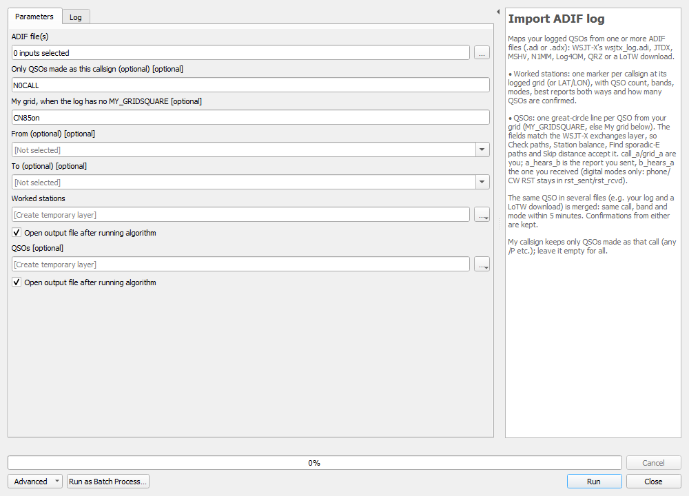
*The Import ADIF log dialog.*

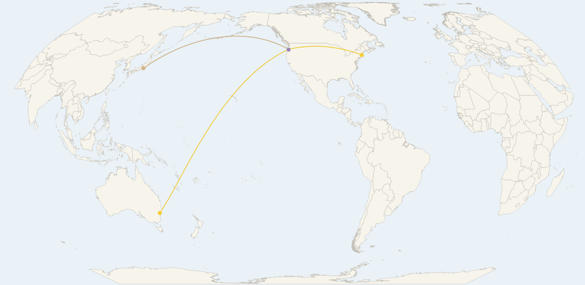
*A 4-QSO sample log (one QSO merged with its LoTW confirmation): QSO lines and worked stations, coloured by band.*

ADIF layers don't appear in the Activity timeline: a log spanning years doesn't suit an hourly chart. Use the layer's filter (right-click → *Filter…*) on `first_utc` to look at a period.

### 7.4 Station balance from two-way reports

In an exchange, each side reports how it hears the other. The path and both antennas are the same in both directions, so the **difference between the two reports** is one station's (transmit power + receiver noise) minus the other's.

#### How it works

The SNR at which station B hears station A is roughly:

```
S(A→B) = A's power + A's antenna gain − path loss + B's antenna gain − B's noise level
```

The reverse report, S(B→A), has the same path loss and the same two antenna gains, because during the minute an exchange takes, the signal travels the same path both ways. Subtract one report from the other and the path and both antennas cancel:

```
      A ──────── same path, same antennas ──────── B
      │   S(A→B): how B hears A                    │
      │   S(B→A): how A hears B                    │

S(A→B) − S(B→A) = (A's power + A's noise) − (B's power + B's noise)
```

So each exchange with both reports measures one number: how much **"louder or deafer"** A is than B. The plugin calls a station's (power + noise) its **balance**:

- A high balance means a strong transmitter and/or a noisy receiver. Others hear this station better than it hears them: **loud but deaf**.
- A low balance means a weak signal and/or a quiet receiver: **good ears**.

One exchange compares two stations. Stations that work several partners link up into a network: if A is 5 dB above B and B is 3 dB above C, then A should be about 8 dB above C. The tool fits every station's balance to all the differences at once (least squares). Only differences are measured, so each connected group of stations is shifted so that its average is 0. `group_size` is how many stations are in that group. Balances can only be compared within one group and one band.

Two things make the fit sturdier than a plain average:

- **Robust fitting (Huber).** Fading can make one exchange 20–30 dB off. An exchange that disagrees strongly with the rest of the fit gets less weight, so one wild exchange barely moves a station's balance.
- **Censoring.** A report at or below **−20 dB** is near the decode floor: the signal was decoded only because it faded up for that slot, so the typical level was lower. A report at or above **+15 dB** is compressed by WSJT-X's detector, so the true level was higher. Such reports are used only as limits ("at most" or "at least"), not as exact values. When an exchange's two limits point in opposite directions, the exchange carries no information and is left out. `n_censored` and `n_dropped` count these per station.

`std_err_db` is the fit's estimate of how uncertain the balance is: the typical scatter between the two reports of an exchange, divided by √(number of exchanges). The scatter is measured from the data, but only from exchanges between stations seen several times. A station seen once always fits its one exchange perfectly, which says nothing about the scatter. With too little such data it uses 7 dB, typical for real FT8 data. In practice `std_err_db` is about **6–7 dB ÷ √n_two_way**: about 3 dB with 5 exchanges, 2 dB with 10, 1 dB with 40.

A station is marked **uncertain** when it has fewer usable exchanges than *Exchanges needed for a verdict*, or a standard error over 3 dB.

| Verdict | Balance | Meaning |
|---|---|---|
| loud but deaf | above +3 dB | Strong signal and/or a noisy receiver: others hear it better than it hears them. |
| balanced | −3 to +3 dB | |
| good ears | below −3 dB | Weak signal and/or a quiet receiver. |
| uncertain | | Too few usable exchanges, or a standard error over 3 dB. |

Each station row also carries plain facts: how many `partners` it had, their `median_km` and `max_km` (and the `farthest` one), its `bands`, and the median report others gave it (`heard_db`) and it gave others (`hears_db`).

It also compares **what you hear with what they hear**. When you decode a signal and the station it was sent to reports it, `hears_vs_me_db` is how that station heard it minus how you did (median). Positive means they hear those signals better than you.

| Setting | Default | Notes |
|---|---|---|
| Exchange layer(s) | | Live, saved-session, ALL.TXT or ADIF QSO layers. Several can be combined. |
| My callsign (marks my own row) | stored callsign | |
| Separately per band | on | Noise floors differ by band. |
| Exchanges needed for a verdict | 3 | |
| Station balance | temporary layer | Points coloured by verdict. |
| Exchanges with contrasts | off | Optional copy of the exchanges with `report_diff_db`, `b_vs_me_db`, `a_vs_me_db`. |


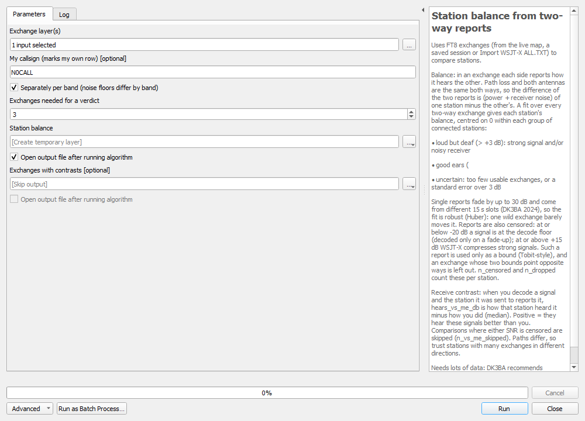
*The Station balance dialog.*

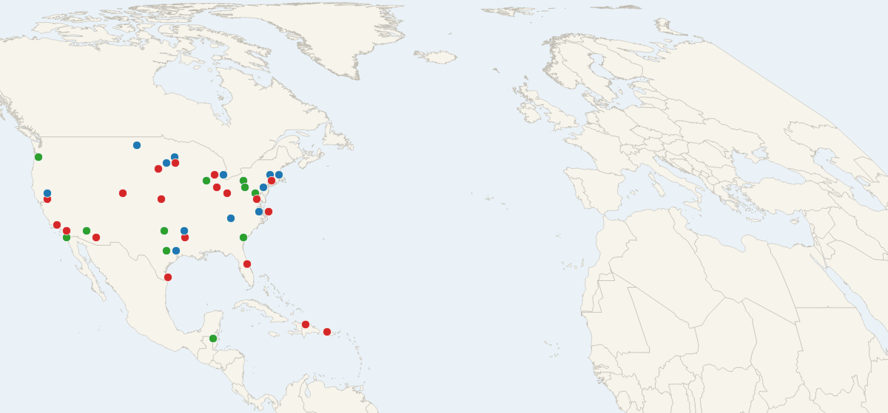
*The 60 stations with the most two-way exchanges in one day's ALL.TXT: 25 loud but deaf (red), 17 balanced (green), 18 good ears (blue). Made before version 0.9.3's standard-error fix; with it, a few of these stations become balanced or uncertain. One day is far less than the ~100 exchanges per station recommended, so read this as an illustration.*

#### Example

These numbers are from a real run: one day (11 November 2026) of the author's ALL.TXT, imported with *Import WSJT-X ALL.TXT*.

**One exchange.** On 20m, W7ASS and W8F completed an exchange. W7ASS sent W8F −15 (W7ASS heard W8F at −15 dB) and W8F sent W7ASS −8 (W8F heard W7ASS at −8 dB). In the layer that is `a_hears_b` = −15 and `b_hears_a` = −8. So:

```
S(W7ASS→W8F) − S(W8F→W7ASS) = −8 − (−15) = +7 dB
```

Taken alone, this says W7ASS is 7 dB "louder or deafer" than W8F. But in the same day's data, the two reports of one exchange differed from each other with a spread of about 9 dB (standard deviation). One exchange tells you very little.

**One day on 15m.** On 11 November 2026 (UTC) the log held 947 two-way exchanges on 15m. 175 of them had a report at the floor or compressed. They linked 619 stations, 584 of them in one connected group. The median station appeared in only 2 exchanges, so most stations come out **uncertain**: 494 uncertain, 60 loud but deaf, 27 good ears, 38 balanced. The scatter measured from the well-observed stations was 6.0 dB. The best-observed stations:

| call | balance_db | std_err_db | n_two_way | n_censored | verdict |
|---|---|---|---|---|---|
| KH8A | −5.4 | 0.84 | 50 | 7 | good ears |
| V31MA | −0.9 | 0.92 | 46 | 13 | balanced |
| JF8CFI | −0.9 | 1.03 | 32 | 3 | balanced |
| W5RBD | +2.1 | 1.24 | 26 | 9 | balanced |
| K2PL | +8.3 | 1.34 | 23 | 9 | loud but deaf |

KH8A hears its partners about 5 dB better, relative to how they hear it, than the average station in the group does, give or take about 1 dB. W5RBD's +2.1 ± 1.2 dB can't be told apart from 0: "balanced".

#### Reading the results

1. **Start with `n_two_way` and `std_err_db`.** A balance of +4 ± 3 dB says little; +8 ± 1 dB says a lot. Read the balance as "somewhere within about two standard errors of this".
2. **Then look at the size of the balance.** ±3 to ±6 dB is ordinary station-to-station variation. +10 dB or more usually means a high-power station, or one with a noisy receiving location. −10 dB or less usually means a low-power station with a quiet location and a good receive antenna.
3. **Find your own row** (`is_me` = 1). If you come out **loud but deaf**, others hear you better than you hear them: look for local noise (QRM), or you may be running more power than most. **Good ears** means your receive side is relatively strong.
4. **Compare bands separately.** With *Separately per band* on, each band has its own groups and centring. A station can be loud but deaf on 20m and balanced on 15m, because noise levels differ by band.
5. **`hears_vs_me_db`** answers a different question: for the same signal, did the other station hear it better than you? A large positive value for many stations in many directions points at your receive side.

#### Limits

- FT8 reports are noisy. Single reports fade by up to 30 dB and the two reports come from different 15-second slots. The fit is robust (one wild exchange barely moves it), but it needs **lots of data**: averaging about 100 exchanges per station is recommended (DK3BA 2024). An hour of decoding gives a few per station.
- **`std_err_db` covers fading scatter only.** It assumes each exchange's error is independent. It doesn't cover a station that changes power or antenna during the day, or a station whose partners are all in one direction. Before version 0.9.3 it was far too small on sparse data (about ±0.2 dB where ±1 dB was right), because stations seen once pulled the scatter estimate down.
- Reports at or below −20 dB are at the decode floor, and at or above +15 dB WSJT-X compresses them. Such reports are used only as limits, not exact values; `n_censored` and `n_dropped` count them.
- The balance mixes power and noise. It can't tell a 1 kW station on a quiet hilltop from a 100 W station in a noisy suburb if both come out the same.
- Propagation isn't perfectly reciprocal (polarisation and fading change within seconds), which is part of the scatter.
- For `hears_vs_me_db`, paths differ between you and the other station. Trust stations with many exchanges in different directions.

#### Try this

- **Collect a week.** Save the live map's session every day, then run the tool on all of them together (*Exchange layer(s)* takes several layers). Watch `n_two_way` grow and the verdicts settle.
- **Test a change at your station.** Run a few days, change one thing (a preamp, a noise-cancelling device, power level), run a few more days, and compare your own balance before and after. A real change should move it by several dB.
- **Look at the exchanges.** Turn on *Exchanges with contrasts* and sort by `report_diff_db` to see the exchanges behind a surprising verdict.
- **Day against night.** Filter the input layers by time (right-click → *Filter…* on `first_utc`) and run once for daytime and once for night-time. Noise levels, and so balances, often change.

### 7.5 Antenna A/B comparison

Compares two antennas (or receivers) that decode the same band at the same time. When both decode the same message in the same 15-second slot, the transmitter, its antenna and the path are identical, so:

> SNR(A) − SNR(B) = difference between the antennas towards that station + a fixed receiver offset

Binned by direction, distance and takeoff angle, this shows the **relative** pattern of the two antennas.

#### Setting up two receivers

Either:

- **Two WSJT-X instances** on the same band at the same time, each on its own antenna and radio (or receiver). Start the second with `wsjtx --rig-name=B` so each keeps its own settings and its own `ALL.TXT`. Or:
- Point both at the live map (both on the same multicast address) with session saving on. The session then holds both instances' decodes, told apart by their WSJT-X id (for example `WSJT-X` and `WSJT-X - B`). The tool's log lists the ids it found.

Keep both running for as long as you can. A few hours gives a direction pattern; elevation needs days covering day and night.

#### Settings

| Setting | Default | Notes |
|---|---|---|
| Receiver A: ALL.TXT file(s) | | Same period as B. |
| Receiver B: ALL.TXT file(s) | | |
| …or a live / saved session layer | | Instead of files: a session layer with two WSJT-X instances. |
| Session: WSJT-X id for A / B | busiest / second busiest | The log lists the instances found. |
| My grid (where both antennas are) | stored grid | |
| Takeoff angle from | Ionosphere: KC2G when recent, else the CCIR model | Or *CCIR model only*, or *Fixed 300 km layer (geometric)*. |
| Sunspot number R12 for the model | 0 (look it up) | |
| Reference antenna pattern | empty | Optional. A CSV or NEC-2 output file; see [Reference antenna](#reference-antenna-absolute-gain). |
| Reference pattern is antenna | B | Which antenna the pattern describes. |
| Reference orientation (°) | 0 | Compass bearing of the pattern's azimuth 0 (the model's +X axis). |
| Wedge radius on the map (km) | 2500 | Only changes the drawing. |

#### Outputs

- **Antenna A vs B by direction**: 16 wedges around your grid. Green means A is stronger, purple means B is. Labels show the median, the number of pairs, and `+only A/only B`.
- **Antenna A vs B by station**: one point per station heard.
- **Antenna A/B by distance and takeoff**: a table with one row for everything, then rows by distance band and by takeoff-angle band (0–3°, 3–6°, 6–10°, 10–15°, 15–25°, 25–90°, and *Es*).
- **Antenna A/B matched decodes** (off by default): a table with one row per decode from a station with a grid, both pairs and single decodes.

**Read `decode_adv` next to the median.** Below the decode floor (about −20 dB) the weaker antenna doesn't report a low SNR; it reports nothing. A median over matched pairs alone hides that. `only_a`, `only_b` and `decode_adv` show it.


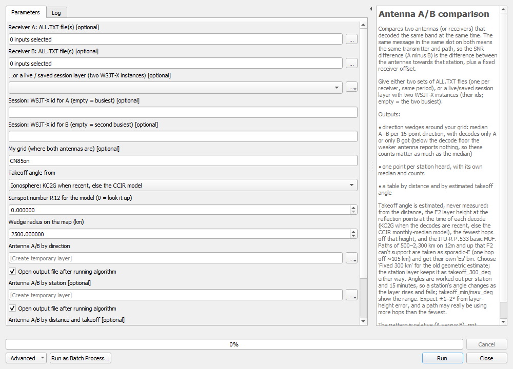
*The Antenna A/B comparison dialog.*

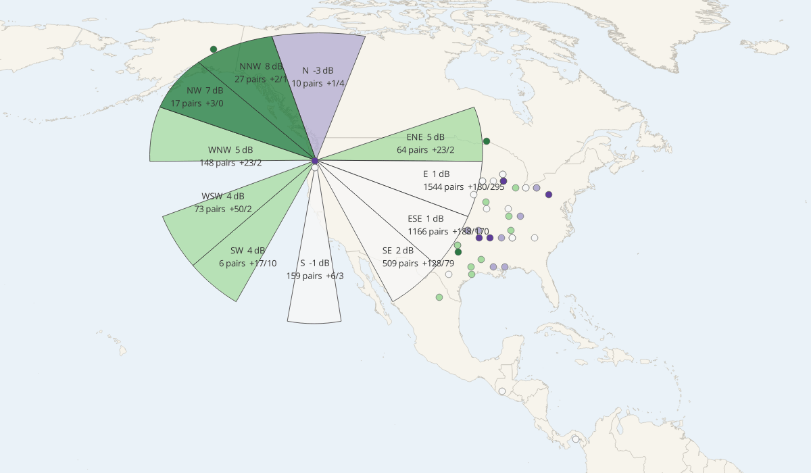
*A vertical (A) against a loop (B), from about 75 minutes of 2022 recordings: direction wedges (green = A stronger, purple = B stronger; labels give the median, pairs and only-A/only-B decodes) and the 60 stations with the most matched decodes.*

#### How the takeoff angle is estimated

The takeoff angle is **estimated, never measured**. FT8 carries no arrival-angle information. With the default setting, for each station and each 15 minutes:

1. Take the F2 layer height (hmF2) at the reflection points at that time: KC2G if the decodes are recent (within 3 hours), else the CCIR monthly-median model.
2. Use the fewest hops off that height that cover the distance.
3. Check the ITU-R P.533 basic MUF. Paths of 500–2,300 km on 12m and up that F2 can't support are taken as sporadic-E (one hop off ~105 km) and go in the *Es* bin instead.

Because the layer rises and falls through the day, the same station is heard at different angles at different times. `takeoff_min_deg` and `takeoff_max_deg` show the range. `takeoff_300_deg` keeps the simple fixed-300 km estimate for comparison.

**Limits**

- Expect about ±1–2° from layer-height error.
- A path may use more hops than the fewest, at a much higher angle. Around 3,300 km the estimate can jump between one hop (~2°) and two hops (~14°).
- The result is a **relative** pattern (A versus B), not absolute gain, unless you give a reference pattern (below).
- Fading makes single pairs noisy (about 5 dB scatter). Trust bins with about 100 pairs or more.

#### Reference antenna (absolute gain)

A **reference antenna** is a simple antenna whose pattern you can model well, for example a half-wave dipole at a known height over your ground. Make it antenna B. Model it in NEC software and give the tool its pattern. Then, for each pair:

> A's gain (dBi) = B's modelled gain towards that station, at that decode's takeoff angle + the measured A − B

So A's results come out in dBi, with ground effects included, instead of only "better or worse than B". Set *Reference pattern is antenna* to A if the reference is on receiver A; the other antenna's gain is then the reference gain − (A − B).

**Making a pattern.** Three ways:

- **4nec2 or NEC-2.** Model the antenna with real ground and an RP card that covers the full circle of azimuth and 0–90° elevation. For example `RP 0 91 73 1000 90 0 -1 5` (θ from 90° down to 0° in 1° steps, φ 0–360° in 5° steps). Give the tool the output file (4nec2 writes it as `.out`). The tool reads every *RADIATION PATTERNS* table, one per frequency, and uses the TOTAL gain. With several frequencies, each decode uses the nearest one; decodes more than 10% away from every frequency get no reference gain.
- **A CSV** from any software, or by hand: one row per point, with a header.
- **EZNEC**: its export formats aren't read. Copy its far-field table into the CSV layout.

The CSV needs columns `azimuth_deg`, `elevation_deg` and `gain_dbi`, separated by commas, semicolons or tabs. Headers are matched loosely (`Az`, `El`, `Gain dBi` also work). Lines starting with `#` are skipped. An optional `frequency_mhz` column lets one file hold several bands. Example (made-up numbers):

```
# dipole, 14.1 MHz, 10 m high, wire along azimuth 90–270
azimuth_deg,elevation_deg,gain_dbi
0,5,-1.8
0,10,3.4
90,5,-12.0
90,10,-6.9
...
```

Every azimuth needs a value at every elevation. Give the full circle of azimuths: symmetry isn't assumed. Use small elevation steps (1–2°) from 0 to about 30°, where most DX arrives.

**Conventions.**

- **Elevation** is degrees above the horizon. NEC's THETA is measured from the zenith, so elevation = 90 − THETA.
- **Azimuth** in the CSV is clockwise, like a compass, from the pattern's reference direction. NEC's PHI is counter-clockwise from the +X axis, so the tool uses azimuth = −PHI.
- **Orientation** is the compass bearing that the pattern's azimuth 0 (NEC's +X axis) points to. With the default 0, +X points north and NEC's +Y points west. If you drew the model with +X east, enter 90. For a dipole whose wire runs along +X, its broadside lobes then point north and south.
- A pattern with **one elevation** is taken as the same at every elevation; one with **one azimuth** (for example only azimuth 0 for a vertical) as the same in every direction. Both give a warning.
- Gain is interpolated bilinearly between pattern points, wrapping through north. Takeoff angles outside the pattern's elevations get no value. NEC prints −999.99 dB where there is no radiation; gains below −40 dBi are raised to −40.

**New fields.** With a pattern, every output adds `abs_n`, `abs_dbi`, `abs_lo_dbi`, `abs_hi_dbi` and `ref_dbi` (see [10.5](#105-analysis-layers)), and the matched decodes table adds `ref_gain_dbi` and `abs_gain_dbi`. The log prints the overall and per-takeoff-band medians.

**Limits.**

- **Only as good as the model.** Ground constants, height, nearby objects and feed-line currents all change a real dipole's pattern. Expect a few dB of model error, most of it at low angles.
- **The takeoff angle is estimated, not measured** (see above). Near the horizon a dipole's gain changes by several dB per degree, so a 1–2° angle error moves the absolute value there by several dB. A path using more hops than the fewest arrives at a quite different angle.
- **Censoring.** Only pairs carry an absolute value. Decodes one antenna missed stay counts, as before. Where the measured antenna misses many decodes, its median is too high, because only its stronger decodes are paired. Where the reference misses many, it is too low. Read `decode_adv` next to `abs_dbi`.
- **The two receivers must match.** A − B includes any fixed receiver offset (gain, noise floor, AGC). Use the same radio model and settings on both, or swap the antennas between receivers for a while to measure the offset.
- **SNR is not gain.** When outside noise sets the floor, a better antenna also hears more noise. The result is then closer to A's directivity against B than to its true gain, and local noise picked up by one antenna shifts every value.
- **Polarisation.** Sky-wave signals arrive with changing polarisation, so the TOTAL gain is used. A pattern's vertical or horizontal part alone would mislead.
- **Statistics.** `abs_lo_dbi`–`abs_hi_dbi` is a 95% interval for the median from fading scatter only. It doesn't cover model or angle error.

### 7.6 Summarize exchanges by grid pair (corridors)

A busy evening gives thousands of exchange lines, too many to read. This tool merges them into **corridors**: one line per pair of grid cells and band, carrying medians of the reports in each direction. Single FT8 reports fade by 20–30 dB; a median over many exchanges is far more trustworthy.

It works on any exchange layer: live, saved session, ALL.TXT, ADIF QSOs, or the output of *Check paths*. Several layers are combined.

| Setting | Default | Notes |
|---|---|---|
| Exchange layer(s) | | Several can be combined. |
| Cell size | Square | **Field** (`EM`, for a world map), **2×2 squares** (a middle ground, named by the south-west square: `EM68` covers EM68, EM69, EM78 and EM79) or **Square** (`EM78`, for a regional map). |
| Separately per band | on | |
| From / To | | Optional time window (UTC), on each exchange's `first_utc`. |
| Least exchanges per corridor | 3 | Hides one-off pairs. |
| Exchange corridors | temporary layer | Lines coloured by median SNR, wider with more exchanges. |

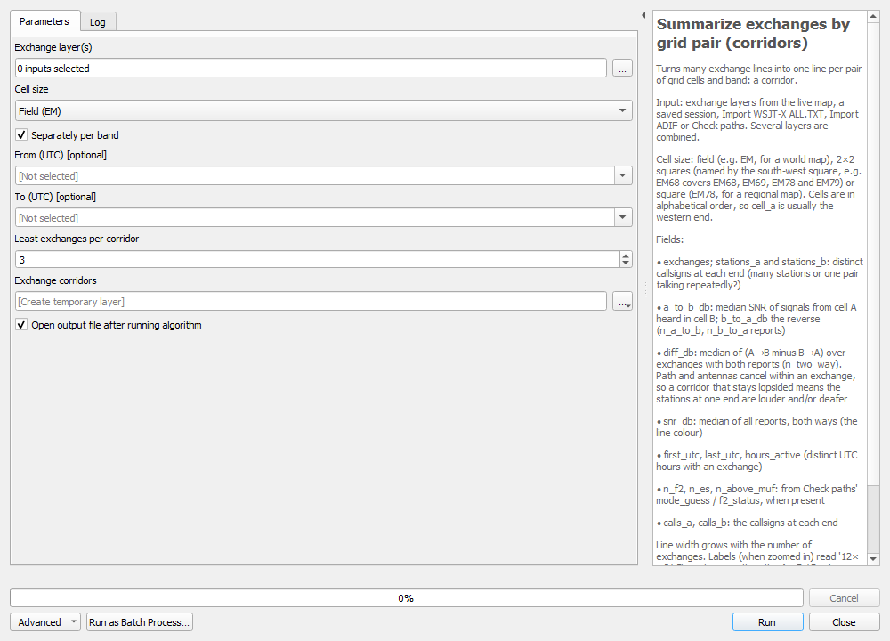
*The Summarize exchanges by grid pair dialog.*

#### How it works

Each exchange is placed in the cells of its two grids. The two cells are put in alphabetical order, `cell_a` before `cell_b`. Because the first locator letter is longitude, `cell_a` is usually the western end. An exchange stored the other way round has its reports swapped, so each direction stays separate:

- `a_to_b_db`: median SNR of signals **from cell A heard in cell B**;
- `b_to_a_db`: the reverse;
- `diff_db`: the median, over exchanges with **both** reports, of (A→B minus B→A). As in [7.4](#74-station-balance-from-two-way-reports), path and antennas cancel within one exchange. A corridor that stays lopsided over many exchanges means the stations at one end are, on the whole, louder and/or deafer than at the other.

`diff_db` isn't simply `a_to_b_db − b_to_a_db`: the two medians use every report in that direction, while `diff_db` uses only exchanges with both. Trust `diff_db` for balance; use the two medians for "how strong is this path".

Exchanges inside one cell have no line to draw. The log counts them, along with exchanges without a grid, outside the time window, and on corridors with too few exchanges.

`stations_a` and `stations_b` count distinct callsigns at each end. A corridor with `stations_a` = 1 is one station (often a DXpedition) working many; one with many stations at both ends is a genuinely open path.

#### Example

The author's live map on 11 November 2026, 19:42–23:44 UTC: 3,036 exchanges, nearly all on 15m. With 3 or more exchanges per corridor:

| Cell size | Corridors | Exchanges within one cell |
|---|---|---|
| Field | 160 | 117 |
| 2×2 squares | 262 | 18 |
| Square | 137 | 10 |

At field size, 160 lines cover 2,705 of the 3,036 exchanges. The busiest:

| cell_a | cell_b | exchanges | stations_a | stations_b | a_to_b_db | b_to_a_db | diff_db (n) | distance_km | hours_active |
|---|---|---|---|---|---|---|---|---|---|
| EM | EN | 135 | 60 | 45 | −0.5 | −4.0 | −2.0 (30) | 1,112 | 4 |
| EM | FN | 127 | 57 | 47 | −1.0 | −1.5 | +3.0 (62) | 2,026 | 5 |
| EM | PM | 109 | 46 | 49 | −13.0 | −11.0 | −5.5 (26) | 11,193 | 3 |
| FN | PM | 91 | 38 | 44 | −14.5 | −15.0 | −1.0 (25) | 10,894 | 3 |

So the US–Japan corridors (EM–PM, FN–PM) were open for three hours with dozens of stations at each end, at a typical −11 to −15 dB, about 10–15 dB weaker than the domestic paths. EM–PM has a −5.5 dB `diff_db` over 26 two-way exchanges: the Japanese stations heard the EM stations better than the reverse, more than fading alone would explain.

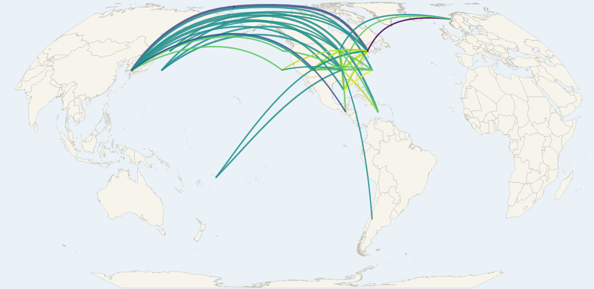
*The 40 busiest field corridors (19 or more exchanges each) from the same evening. Width shows exchanges; colour shows median SNR (purple weak, yellow strong). Most of the traffic runs between the US and Japan.*

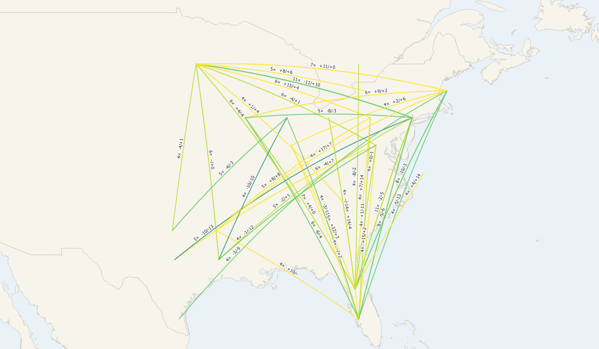
*Zoomed in at 2×2-square size: 40 busy corridors in the central and eastern US. A label such as `11×  -11/+10` gives the number of exchanges, then the median SNR from the first cell to the second and back (– where there was no report that way).*

#### Reading the results

1. Start at **field** size for a world view, then rerun at **2×2 squares** or **square** over a region.
2. **Width = how much traffic; colour = how strong.** A wide, dark (weak) line is a busy marginal path, often a DX opening.
3. **Check `stations_a` and `stations_b`** before reading anything into a corridor.
4. **`hours_active`** separates a brief opening from a path that stayed open all evening. Use *From / To*, or run once per hour, to watch it move.
5. If the input went through *Check paths*, `n_f2`, `n_es` and `n_above_muf` show how each corridor was probably propagating.

#### Try this

- **Day against night**: run the same session with two time windows and compare the corridors.
- **A week of sessions**: give every saved session at once, at field size, to see your region's regular paths.
- **Only your QSOs**: run it on your ADIF QSOs to see which corridors your own contacts use.

### 7.7 Propagation over time (time slider)

*Plugins → Maidenhead Mapper → WSJT-X → Propagation over time (ALL.TXT)* opens a panel that turns an ALL.TXT file into an animation. It shows, hour by hour or day by day, which areas could work which. Each frame shows the corridors (as in [7.6](#76-summarize-exchanges-by-grid-pair-corridors)) of that hour and the grid cells that were active. QGIS's own **Temporal Controller** (the time slider) plays them.

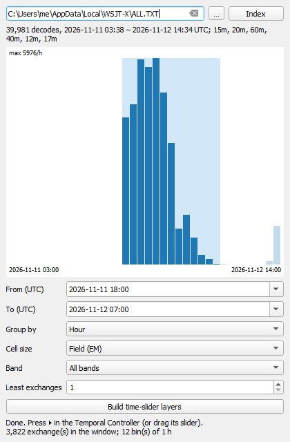
*The panel after indexing: the chart shows decodes per hour; the shaded part is the chosen window.*

#### Step by step

1. **Choose the file(s).** The panel suggests WSJT-X's own `ALL.TXT`. Several files can be chosen (e.g. one per radio, or old files you kept).
2. **Index.** The panel scans the files once for their dates, bands and decodes per hour. This reads about 30 MB a second. The index is saved; next time only lines WSJT-X has added since are scanned. The summary line shows the time span and the bands.
3. **Choose the window.** Drag across the chart, or set **From** and **To** (UTC). The panel starts with the last 24 hours.
4. **Choose the grouping and area size.**

   | Setting | Choices | Notes |
   |---|---|---|
   | Group by | Hour, 3 hours, Day | One frame of the animation per group. |
   | Cell size | Field, 2×2 squares, Square | Field suits a world map. |
   | Band | All bands, or one band | The list shows the bands in the files, busiest first. |
   | Least exchanges | 1 | Hide corridors with fewer exchanges in a frame. |

5. **Build time-slider layers.** This runs in the background. Two layers appear, and the Temporal Controller opens, set to the window and one frame per group.
6. **Press ▶** in the Temporal Controller, or drag its slider. Use its settings (the cog) to change the speed; tick *Cumulative range* to keep earlier frames visible.

Only the chosen dates are read, starting 6 hours earlier so that stations' grids seen just before the window are known.

**Saving an animation.** In the Temporal Controller, the *Export animation* button (the film icon) writes one PNG per frame. A video tool, or the separate *Animation Workbench* plugin, can turn them into a video.

**Why not a time plugin?** This uses QGIS's built-in Temporal Controller (QGIS 3.14 and later). The older *TimeManager* plugin it replaced isn't needed. Maidenhead Mapper's part is the data: indexing ALL.TXT, rebuilding exchanges, and giving each corridor its frame's start and end time.

#### The layers

**Corridors over time**: one line per pair of cells per frame.

| Field | Meaning |
|---|---|
| `bin_start`, `bin_end` | The frame (UTC). The line shows only while the slider is in it. |
| `seen` | `both ways`: each end reported the other (solid line). `A→B only` / `B→A only`: only one direction reported (dashed). `no reports`: only calls seen (dotted grey). |
| `exchanges`, `stations_a`, `stations_b` | As in 7.6. |
| `a_to_b_db`, `b_to_a_db`, `diff_db`, `snr_db` | Medians, as in 7.6. Colour is `snr_db`. |
| `distance_km`, `bands`, `calls_a`, `calls_b`, `label` | |

**Active cells over time**: one polygon per active cell per frame, shaded by `stations` (distinct calls in exchanges), with `exchanges`, `partner_cells` and `partners` (the cells it reached).

Both are temporary layers; right-click → *Make Permanent* to keep them. The same tool is in the Processing Toolbox as *Corridors over time from ALL.TXT*, for batch runs or models; run from there, the layers are time-enabled too.

#### Example

The author's ALL.TXT, 11 November 2026, 18:00 UTC to 12 November 06:00 UTC, by hour, at field size: 3,822 exchanges with both grids known, in 12 hourly frames. Three of them, each showing the 40 busiest corridors:

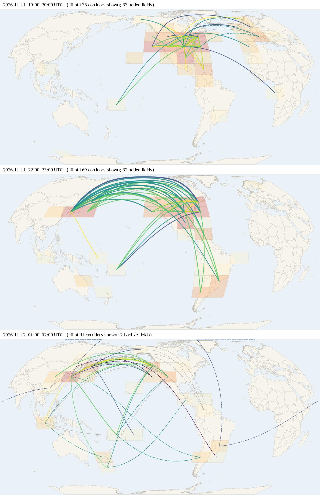
*19:00 UTC: North America works Europe and West Africa. 22:00 UTC: Europe has closed; Japan and South America are open. 01:00 UTC: the activity has moved west, to the Pacific, Asia and Australia, with many one-way (dashed) paths.*

Most of these decodes were on 15m. The pattern fits the day–night line moving west: as darkness reaches Europe the paths there close, while paths across the Pacific open.

#### Limits

- **Only what you decoded.** A corridor between two other stations appears only if you decoded both, or at least one, of them. Your receiving location shapes what you see: you hear stations near you and stations your band is open to.
- **Grids.** An exchange needs both stations' grids. In a busy evening about 40% of exchanges lack one, because the station never sent a CQ or grid in the decoded window.
- **No activity is not no propagation.** An empty frame may mean nobody was on, or that you weren't listening.
- One-way (`A→B only`) corridors often mean only one side's message was decoded, not that the path was one-way.

### 7.8 Export research dataset

*WSJT-X → Export research dataset…* writes your `ALL.TXT` decodes as a table for research: **one row per observed SNR**. Files from many operators can be stacked into one table and shared, for example with HamSCI or on Zenodo. The output is a CSV file plus a `<name>.schema.json` file that describes it. The full schema is in [research-export-schema.md](research-export-schema.md).

| Setting | Default | Notes |
|---|---|---|
| ALL.TXT file(s) | | One or more files. Don't mix logs from two receivers covering the same time. |
| From / To (UTC) | empty (all) | Rows from *From* up to, not including, *To*. Reading starts 6 hours earlier to learn grids. |
| Band | empty (all bands) | e.g. `20m`. |
| My callsign | stored callsign | Required: your decodes are measured at your station. Read from your settings, never changed. |
| My grid | stored grid | Your end of every path you decoded. |
| Decode floor | −24 dB | Reports at or below it are marked `censored`. |
| Grid precision at most | 6 characters | Or 4, to share less about where you are. |
| Pseudonymise callsigns | off | Replaces every callsign with a code; grids are kept. |
| Salt for pseudonyms | empty | A secret word mixed into the codes. Use the same salt every time so codes match across exports. Never publish it. |
| Add the basic MUF, f/MUF and sporadic-E flag (CCIR model) | on | Fills `muf_basic_mhz`, `f_over_muf` and `es_candidate` for 12m/10m. Needs the CCIR coefficients (downloaded once) and a sunspot number. Untick to leave them empty. |
| Sunspot number R12 for the model | 0 (look it up) | As in *Check paths*: SILSO, or KC2G's effective sunspot number for the last few days. Enter one for dates neither covers (the last month or so before SILSO publishes it). |
| Research dataset (CSV) | temporary file | Choose a file name to keep it. The `.schema.json` is written next to it. |

#### What a row is

Three kinds of row (`report_kind`):

- **exchange_report**: the report one station sent another. `W4XYZ K1ABC -05` means K1ABC hears W4XYZ at −5 dB, so `tx_call` = W4XYZ and `rx_call` = K1ABC. A report repeated in the same exchange is one row; `n_decoded` counts the repeats.
- **my_decode**: your receiver decoded a message. `tx_call` = the sender, `rx_call` = you. Every decode is a row, CQs included.
- **not_decoded** (since 0.15.0): a transmission that the receiving station evidently didn't decode. No SNR (`snr_db` empty), `censored` = 1, `n_decoded` = 0. See below.

`exchange_id` links both directions of an exchange and your decodes of each side. One overheard exchange can give four SNRs: A→B, B→A, A→you and B→you. That is what lets a model separate station effects from path effects (TODO item 13).

Each row with both grids also gets the path: distance, bearing, the fewest F2 hops (300 km layer), control points (the midpoint up to 2000 km, else 1000 km from each end), the solar zenith angle there and `day_night`. The fields are listed in [10.6](#106-research-dataset).

#### MUF and sporadic-E per row (schema 1.1)

- `muf_basic_mhz`: the path's **basic MUF** at the row's time from the **CCIR monthly-median model**, worked out exactly as *Check paths* does with *CCIR model only* (P.533 control points, fewest hops; the time rounded down to 15 minutes). KC2G isn't used: it only has the present, and exports are of the past.
- `f_over_muf`: `freq_mhz / muf_basic_mhz`. Over 1 means above the basic MUF. Like "above basic MUF" in *Check paths*, that is worth a look, not proof of anything: the operational MUF is a bit higher, and on any one day the ionosphere can be ~20% off the monthly median.
- `es_candidate`: 1 where *Find sporadic-E paths* would say **high** confidence: 12m to 2m at single-Es-hop distance (500 to ~2,300 km), and on 12m and 10m only when the frequency is above the basic MUF. 0 where the rule says no. Empty when it can't be told: no grids, or 12m/10m in range without a MUF.
- `foes_min_mhz` (with `es_candidate` = 1): the lowest Es critical frequency that returns that frequency at that distance.

#### Rows for transmissions that weren't decoded

WSJT-X sends the same message again until it decodes the answer. So when, in an exchange,

1. station S sends T a message (a call or grid, a report, or a roger report),
2. in the next slot T sends S the answer to it (a report, a roger report, or RR73/RRR), and
3. in the slot after that S sends **exactly the same message** again,

S did not decode T's answer. That answer becomes a `not_decoded` row: `tx_call` = T, `rx_call` = S, the time and frequency of T's message. You must have decoded all three messages (or sent T's message yourself: then the row says S missed you). FT8 and FT4 only, with the messages one slot apart.

What it is **not**: proof the path was closed. S may have missed T because of QRM, because S's operator held the message, or because S decoded it too late to change the next transmission. Your own repeats never count: you may have decoded the answer and sent the message again anyway. Exchanges that just stop are not counted either: the other station may simply have stopped, or gone to someone else.

#### Example

The author's ALL.TXT, 11 November 2026 18:00 UTC to 12 November 06:00 UTC: 45,913 rows (6,886 exchange reports, 38,593 of the author's decodes and 434 not_decoded) from 8,578 exchanges and 2,657 stations. 41,314 rows have both grids, and 41,297 of them a basic MUF (R12 60–61, KC2G's effective sunspot number); 263 decodes are censored at −24 dB. Most are on 15m and 20m. About 19% of the 20m rows and 16% of the 15m rows are above the basic MUF; no row is a sporadic-E candidate (November, and almost nothing on 10m). Building the rows took about 12 seconds, 9 of them for the MUF.

#### Limits

- **Only what you decoded.** A signal you didn't decode is not a row. `not_decoded` rows cover only the clear case above: a missed answer between two identical messages.
- **Censoring.** Below about −24 dB FT8 doesn't decode, so weak signals are missing rather than low. Treat `censored` rows as "this or lower".
- **Grids.** FT8 sends 4-character grids, so a station can be up to ~100 km from its grid's centre. Rows without both grids have empty path fields.
- **Callsigns are kept by default.** Callsigns and grids are sent openly on the air and published by PSK Reporter, so the export keeps them. *Pseudonymise callsigns* is there if a project asks for codes instead; note that grids, times and frequencies can still point to a station.

## 8. Ionosphere

Two sources of ionosphere data are available:

- **KC2G** ([prop.kc2g.com](https://prop.kc2g.com)): current ionosonde measurements (from GIRO and INGV) and worldwide maps of MUF(3000), foF2 and hmF2 built from them over the IRI-2020 model. Updated about every 15 minutes. **"Now" only**: there is no history.
- **CCIR model** (ITU-R P.1239, the F2 maps inside the IRI model): the **monthly median** ionosphere for any date, time and sunspot number. It lets you check old logs. It describes typical conditions for that month, not what happened that day: expect foF2 within about 20%.

### 8.1 Fetch ionosphere (KC2G)

Downloads KC2G's current data and shows it.

| Setting | Default | Notes |
|---|---|---|
| Ionosondes reported within (hours) | 3 | Older stations are left out. |
| Contour map | MUF(3000)F2, MHz | Or *foF2, MHz* or *hmF2, km*. |
| Ionosondes, Ionosphere contours | temporary layers | |

**Outputs**: *Ionosondes HH:MM UTC* (points labelled with the station code) and a contour layer named after the map and time. See [fields](#104-ionosphere-layers).

The data is cached and downloaded again at most every 15 minutes. KC2G is a volunteer service: please don't automate frequent requests.

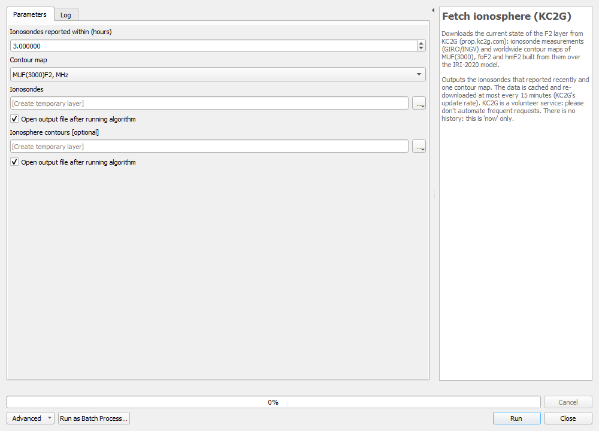
*The Fetch ionosphere (KC2G) dialog.*

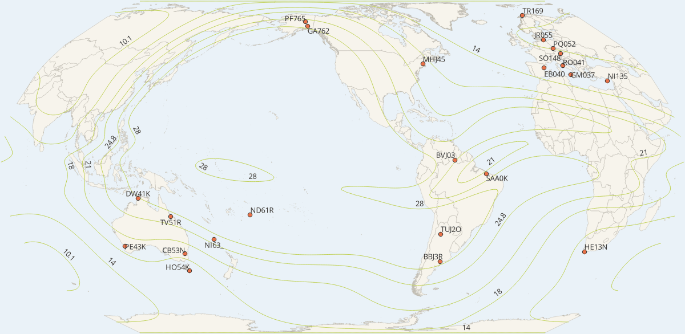
*KC2G ionosondes (labelled by station code) and MUF(3000)F2 contours in MHz, 23:02 UTC.*

### 8.2 Check paths against the ionosphere

For each path in a station or exchange layer, works out whether the F2 layer could have carried it.

| Setting | Default | Notes |
|---|---|---|
| Station or exchange layer | | Any layer with `grid` (station) or `grid_a`/`grid_b` (exchange). |
| My grid (station layers) | from the layer, else stored | Station-layer paths start here. |
| Only paths within this many hours of the ionosphere data | 3 | For KC2G. |
| Download fresh data if the cache is over 15 minutes old | on | |
| Ionosphere source | Auto | *Auto: KC2G when the path is recent, else the CCIR model*; *KC2G only*; *CCIR model only*. |
| Sunspot number R12 for the model (0 = look it up) | 0 | |
| Paths with ionosphere | temporary layer | A copy of the input with new fields. |
| Reflection points | temporary layer | Optional. |
| Also write the results into the input layer | off | Adds the new fields to the input layer itself too. See [Writing into the input layer](#writing-into-the-input-layer). |

**New fields** on each path:

| Field | Meaning |
|---|---|
| `f2_status` | **F2**: the band is at or below the path's MUF. **above basic MUF**: simple F2 hops don't explain it (sporadic-E, scatter, an unusual path, or the map is off). Layers made before 0.15 say *above F2 MUF*; the plugin's tools read both. **no data**: no ionosphere for that time, or no grid or band. |
| `muf_mhz` | The path's F2 **basic MUF** by ITU-R P.533-14. |
| `fof2_mhz`, `hmf2_km` | foF2 and layer height where the MUF was judged. |
| `hops_iono`, `takeoff_iono` | Likely hop count and takeoff angle at the measured layer height. |
| `hops_muf` | The hop count the MUF was worked out with (P.533's rules). Usually the same as `hops_iono`; sometimes one more. |
| `mode_guess` | The most likely way the signal travelled: **F2**, **Es** (sporadic-E), **above basic MUF** or **no data** (*above MUF* in layers made before 0.15). |
| `bands_f2` | Which of the path's bands F2 supports. |
| `freq_mhz` | The frequency judged: the band's FT8 frequency; a station on several bands is judged on its highest. |
| `iono_source`, `iono_utc`, `iono_note` | Which data was used, its time, and why there was none. |

#### How it works

**What the MUF is.** Send a signal straight up and the F2 layer reflects it only up to a certain frequency, the **critical frequency foF2**. Send it up at a slant and the layer can bend back much higher frequencies, because the wave meets the layer at a glancing angle. The **MUF** (maximum usable frequency) of a path is the highest frequency the layer can bend back over that distance. Longer hops meet the layer at a flatter angle, so their MUF is higher, up to about 3–4 times foF2 for the longest single hop. The ionosphere maps describe this with **MUF(3000)**: the MUF for a 3,000 km hop.

```
            F2 layer (hmF2 ≈ 250–350 km)
   ─────────────────●─────────────────
                 ╱     ╲            short hop: steep angle, MUF ≈ 1–2 × foF2
               ╱         ╲          long hop:  shallow angle, MUF ≈ 3–4 × foF2
   ───────── A ─────────── B ─────────  ground
```

A band **fits** a path when its frequency is at or below the path's MUF.

**Where the ionosphere numbers come from.** For each point it needs foF2, MUF(3000) and the layer height hmF2:

- **KC2G** gives the measured maps for *now*. Near a current, trusted ionosonde (confidence 50 or more), the maps are nudged towards its measurements; the correction fades out over about 1,000 km. This also fills in peaks above the top contour (the MUF(3000) map stops at 28 MHz).
- The **CCIR model** gives the *monthly median* for the path's own date and time, at the sunspot number R12 (looked up, or the one you enter).
- **Auto** uses KC2G for paths within *Only paths within this many hours* of its data, and the model for everything older.

**How the MUF is worked out** (ITU-R P.533-14):

- Paths up to one hop's maximum length (at most 4,000 km): at the path midpoint.
- Longer paths: the lower of the values at two *control points*, half a hop in from each end. A long path is only as good as its weakest end.
- Paths over 9,000 km: P.533's long-path method.

This is the **basic** MUF: the ITU-R P.1239 / CCIR value, without P.533's operational adjustment. P.533's *operational* MUF is a bit higher (typically 10–20%), so some paths marked "above basic MUF", especially long ones, may still be normal F2. Treat "above" as "worth a look", not proof of sporadic-E. VOACAP's operational MUF (TODO 26) will give a comparison.

**Hops and reflection points.** The hop count is the **fewest hops** that cover the distance off the layer at a takeoff angle of at least 2°. One hop off a 300 km layer reaches about 3,400 km. The hops are spread evenly along the great circle; each meets the layer at a *reflection point*. The tool reads the layer height at those points, recomputes the hop count, and repeats until it settles. `takeoff_iono` is the takeoff angle for that hop count and height.

The MUF uses P.533's own hop count, `hops_muf`. P.533 requires a takeoff of at least **3°** and hops of at most **4,000 km**, while `hops_iono` allows 2°. On a path near the limit of one hop count, `hops_muf` can therefore be one more than `hops_iono`. Most paths have the same value in both.

**More hops never raise the MUF.** Shorter hops meet the layer at a steeper angle, and a steeper angle means a lower MUF. So the fewest hops always give the highest MUF. If a path is above the MUF with the fewest hops, it is above it with any number of hops: adding hops can't explain it.

**`mode_guess`** puts the two checks together:

- **Es** where sporadic-E is the likely explanation: 6m and up at single-hop sporadic-E range (500–2,300 km), or 12m and 10m at that range when F2 can't carry the path. The same rule *Find sporadic-E paths* calls *high* confidence. Double-hop sporadic-E isn't considered.
- Otherwise **F2**, **above basic MUF** or **no data**, as in `f2_status`.

**Why "above basic MUF" doesn't mean impossible.** Real contacts above the basic MUF happen all the time:

- **Sporadic-E** (see [8.3](#83-find-sporadic-e-paths)) carries short paths on 10m and 6m.
- **Scatter and ground wave** fill in the skip zone close to you, where the F2 MUF for short hops is low.
- The **operational MUF** is higher than the basic MUF.
- **Model error:** the CCIR model is a monthly median and can be 20% off on a given day. KC2G maps are interpolated between ionosondes that may be thousands of kilometres from your path.
- **Unusual paths:** chordal hops, grey-line, or a skewed path that doesn't follow the great circle.

**What it doesn't check.** The MUF is only the upper limit. The tool doesn't say whether a signal is strong enough to decode, or whether absorption closes the lower bands during the day (the LUF).

**Reflection points layer**: `kind` = *hop* (grey dots, where each hop meets the layer) or *control point* (diamonds where P.533 judges the MUF, green if the band fits, red if not). `path_fid` links each point to its path.

The output paths are coloured by `f2_status`: green F2, red above, grey no data.

#### Writing into the input layer

Tick **Also write the results into the input layer** to keep the results with the data itself, for example in a saved live session. The tool still makes the output layer as usual. When the run finishes, it adds any of the new fields (`f2_status`, `muf_mhz`, `hops_iono`, `hops_muf`, `mode_guess` and the rest) that the input layer is missing, and fills them in for every path it checked.

- Works on memory layers and GeoPackages, including the live map's layers and saved sessions.
- If the layer is being edited, or can't be changed (read-only), the tool writes nothing into it and says so in the log. The output layer is still made. Save or cancel the edits and run it again.
- On a live or session layer, exchanges that arrive **after** the run have empty values. An Activity timeline rebuild also empties them: the columns stay, the values don't. Run the tool again to fill them in.

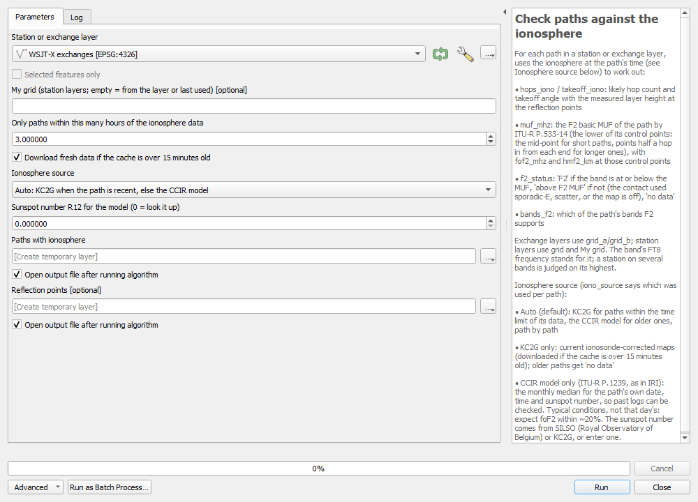
*The Check paths dialog.*

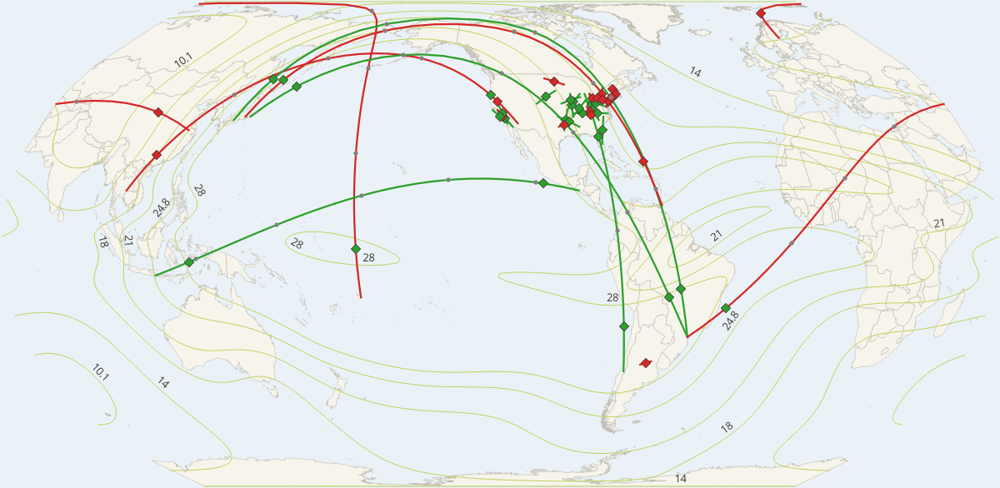
*20 paths the F2 layer supports (green) and 20 above the F2 MUF (red), with their reflection points (grey dots = hops, diamonds = control points) over KC2G MUF(3000) contours.*

#### Example

These are real CCIR-model results (*Ionosphere source* = *CCIR model only*) for paths from CN85 (Oregon) at 21:00 UTC on 11 November 2026. The sunspot number was R12 = 61, from KC2G's effective sunspot number. Overhead, the model gave foF2 = 8.8 MHz, hmF2 = 263 km and MUF(3000) = 28.5 MHz.

| To | Distance | hops_iono | takeoff_iono | muf_mhz | 20m (14.07) | 15m (21.07) | 10m (28.07) |
|---|---|---|---|---|---|---|---|
| DM79 (Colorado) | 1,602 km | 1 | 14.2° | 22.5 | F2 | F2 | above |
| FN42 (Boston) | 4,082 km | 2 | 9.7° | 28.5 | F2 | F2 | F2 (just) |
| PM95 (Tokyo) | 7,843 km | 3 | 5.0° | 19.8 | F2 | above | above |
| IO91 (London) | 7,871 km | 3 | 6.4° | 9.7 | above | above | above |
| QF56 (Sydney) | 12,323 km | 4 | 3.8° | 25.1 | F2 | F2 | above |

What this shows:

- **Short paths have a low MUF.** Colorado at 1,600 km is one steep hop, so 10m doesn't fit even though the overhead MUF(3000) is 28.5 MHz.
- **A long path is limited by its weakest end.** London's MUF is only 9.7 MHz: it was 21:00 local time in Europe, and the control point near the UK had foF2 = 3.2 MHz. Tokyo's control point near Japan (6 a.m. local) had 5.7 MHz.
- **Sydney fits 15m** at 12,300 km. Over 9,000 km the long-path method applies, and both ends were in daylight.

Over the whole 21:00 hour of the same log, 342 different station-and-band paths were decoded on 15m. The model called **299 F2 and 43 above the F2 MUF**. Of the 43, 37 were under 1,430 km, inside the skip zone: local ground wave and scatter, not F2 hops. Only 6 were long paths.

#### Reading the results

1. **Read the counts in the log first.** Mostly F2 is normal. A good share of "above" on long paths, especially on 10m, means the band was better than the model or map expected.
2. **Look at where the red paths are.** Red paths close to you (inside 1,000–2,000 km) are usually the skip zone being filled by scatter or ground wave, or sporadic-E on 10m and 6m. Red long paths are more interesting: an opening the model doesn't predict, grey-line, or a day when the ionosphere is above its monthly median.
3. **Open the reflection points.** A red control-point diamond shows where the path is weakest. On east–west paths it is usually the end in darkness.
4. **Use `bands_f2`.** For a station heard on several bands, it lists which of them F2 supports. The band judged (`freq_mhz`) is the highest one.

#### Limits

- The **CCIR model** is a monthly median: expect foF2 within about 20% on a given day. It doesn't know about storms, flares or sporadic-E.
- **KC2G** has no history. *Auto* uses it only within 3 hours of its data; older paths use the model.
- It works out the **basic** MUF; the operational MUF is typically 10–20% higher.
- It assumes the **fewest hops** at no less than 2° takeoff (3° for the MUF). Real signals may use more hops, but more hops never raise the basic MUF, so this doesn't change `f2_status`.
- A station on several bands is judged on its **highest** band only.
- It judges the F2 layer only: no E layer, no absorption, no signal strength.

#### Try this

- **KC2G against the model.** Run it twice on your live layer, once with *KC2G only* and once with *CCIR model only*, and compare `muf_mhz`. Big differences show the day is unusual.
- **Catch a 10m opening.** On a day 10m opens, run it on the live layer during the opening and see which paths the maps did and didn't expect.
- **Morning against evening.** Run it on a full day's ALL.TXT import and filter the output by `last_utc`. Watch the red paths move as the night side of the Earth rotates.
- **Chain it.** Feed the output into *Find sporadic-E paths*; it uses `f2_status` directly.

### 8.3 Find sporadic-E paths

Finds paths sporadic-E most likely carried: one hop of 500–2,300 km on 12m, 10m, 6m or higher that the F2 layer can't explain.

#### How it works

**What sporadic-E is.** Sporadic-E (Es) is a thin, patchy layer of dense ionisation in the E region, about 100–110 km up. Patches ("clouds") form, drift and fade over minutes to hours. They can be dense enough to reflect 10m, 6m and occasionally 2m signals that the F2 layer can't. Es is strongest in the local **summer** (in the northern hemisphere roughly May to August), with a smaller peak around mid-winter. It favours **late morning and early evening** local time.

**Why 500–2,300 km.** Es is low, so one hop is short. Even a signal leaving the horizon (0° takeoff) comes back down within about **2,300 km** of a 105 km layer. Closer than about 500 km the signal would have to go up very steeply, and Es rarely reflects that. Paths in this window on the higher bands are the classic Es signature. Longer Es contacts exist (two Es hops, or Es linking to F2), but the tool doesn't try to identify them.

```
       Es patch (~105 km)
   ──────────●──────────
           ╱   ╲            one hop: 500–2,300 km
   ────── A ───── B ──────  ground
```

**The rules.** A path becomes a candidate when it is a single-Es-hop distance on one of the chosen bands, and:

- **high** confidence: 6m and up (F2 rarely supports such short paths there), or the band is above the F2 MUF;
- **possible**: 12m or 10m without ionosphere data.

A 12m or 10m path that F2 *can* explain is not a candidate. If the input has been through *Check paths*, its `f2_status` is used. Otherwise, with *Check 12m/10m paths against the ionosphere* on, the tool checks them itself (KC2G if recent, else the CCIR model). With the CCIR model, "above basic MUF" means above the typical MUF for that month, so treat 10m results as likely rather than certain.

**How strong the patch must have been.** The signal hit the patch at a slant, so the patch's own critical frequency (**foEs**) can be much lower than the band's frequency. The secant law gives the least it can have been:

```
foEs_min = f ÷ sec(incidence angle at the layer)
```

Short paths come in steeply, so they need a denser patch. That is why 6m at 1,000 km is more remarkable than 6m at 2,000 km.

**Clouds.** Candidates are placed at the path **midpoint**, where the signal met the Es layer. Candidates whose midpoints are within *Cloud: midpoints within (km)* and *Cloud: and within (minutes)* of each other are linked; linked candidates (also through a chain of neighbours) form one cloud. Clouds of two or more paths go in the clouds layer.

| Setting | Default | Notes |
|---|---|---|
| Station or exchange layer | | |
| My grid (station layers) | from the layer, else stored | |
| Bands | 12m, 10m, 6m, 4m, 2m | |
| Check 12m/10m paths against the ionosphere | on | KC2G if recent, else the CCIR model. |
| Use KC2G for paths within this many hours of its data | 3 | |
| Cloud: midpoints within (km) | 500 | |
| Cloud: and within (minutes) | 60 | |

**Outputs**

- **Sporadic-E candidates**: a point at each path's midpoint (where it met the Es layer). `foes_min_mhz` is the lowest Es critical frequency that returns that band at that distance; `takeoff_es` is the takeoff angle off a 105 km layer; `confidence` and `cloud` as above.
- **Sporadic-E clouds**: candidates within the cloud distance and time of each other, grouped. Each has its count, bands and highest `foes_max_mhz`.

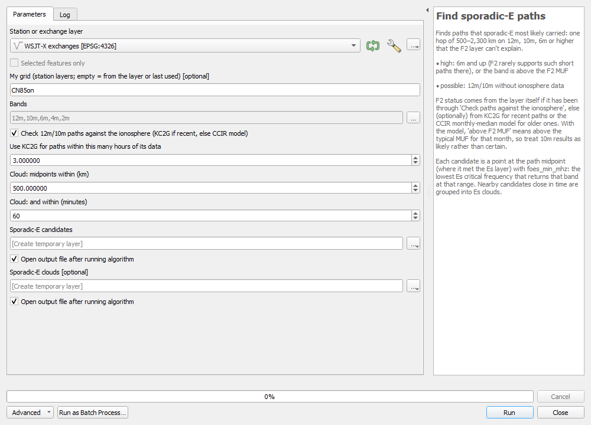
*The Find sporadic-E paths dialog. On the November evening used for these screenshots it found no candidates: sporadic-E is mostly a summer (and short mid-winter) effect, so there is no result map here.*

#### Example

*Illustrative numbers, computed with the plugin's formulas (no Es was found in the November log used elsewhere in this guide).*

Suppose that on a June afternoon your 6m log has a station 1,000 km away, and your 10m log a station 1,500 km away. Both fall in the single-hop window, so both are candidates:

| Band | Distance | confidence | takeoff_es | foes_min_mhz |
|---|---|---|---|---|
| 6m (50.31 MHz) | 1,000 km | high (6m) | 9.5° | 12.2 |
| 6m (50.31 MHz) | 1,800 km | high (6m) | 2.5° | 9.3 |
| 10m (28.07 MHz) | 1,500 km | high if *above basic MUF*, possible without ionosphere data | 4.5° | 5.5 |

The 1,000 km 6m contact needed a patch with foEs of at least 12 MHz, a strong Es event. The 1,800 km contact needed only about 9 MHz. If several such candidates have midpoints within 500 km of each other inside an hour, they form one cloud: one patch of Es, seen from several paths.

#### Reading the results

1. **Look at the clouds layer first.** A cloud of many paths with one midpoint area, for example over Kansas around 18 UTC in June, is one Es patch. Its `foes_max_mhz` says how dense it got.
2. **Follow a cloud through time.** Filter candidates by `cloud` and look at `last_utc`. Es clouds often drift a few hundred kilometres per hour.
3. **Trust 6m more than 10m.** On 6m, short paths are almost always Es. On 10m, F2 can also do 1,500–2,300 km in a strong sunspot year; there the ionosphere check is what separates the two.
4. **Isolated "possible" points** on 10m with no ionosphere data are only hints.

#### Limits

- It recognises **single-hop** Es only. Double-hop Es and Es-to-F2 links (common on 6m in summer) aren't flagged.
- It uses the **path midpoint** as the reflection point and a fixed **105 km** height.
- `foes_min_mhz` is a **lower bound**: the patch could have been denser.
- Paths between two other stations (in an exchange layer) count too. That's useful, because it shows Es far from you.
- Distances come from grid squares, so a 4-character square adds up to about ±100 km.

#### Try this

- **Run it in summer.** Keep the live map running on 6m or 10m during June–July and run it each evening on the saved session.
- **Compare with DX maps.** Compare your clouds with Es maps from other services for the same hour.
- **Use a big dataset.** During a 6m opening, run *Fetch from PSK Reporter* for your own callsign or a busy 6m station's, then use the result as input. Many reporters give many midpoints, and the clouds become clearer.
- **Chain it.** Run *Check paths* first and use its output as the input, so 10m candidates use the full ionosphere check.

### 8.4 Skip distance by hour

A table, per band and UTC hour, of how far contacts reached. It shows the skip zone growing and shrinking through the day.

#### How it works

**What the skip zone is.** When the band's frequency is above foF2, a signal sent up steeply passes straight through the F2 layer and is lost. Only signals sent up at a shallow enough angle come back down, and those land far away. Between the end of ground-wave range (a few tens of km on HF, more with big antennas) and the first sky-wave landing point there is a **skip zone** where nothing is heard. Its outer edge is the **skip distance**.

```
             F2 layer
   ─────────────●──────────●───────
              ╱ │ (steep:  ╱  ╲
            ╱   │  lost)  ╱      ╲
   ──── you ···· skip zone ······· first sky-wave contacts ────
        └ ground wave ┘           └ skip edge (skip_km) ┘
```

As foF2 rises (morning), the layer bends back steeper signals and the skip zone shrinks. As foF2 falls (evening), the skip zone grows, until the band closes.

**Why the 10th percentile.** The tool doesn't use the single closest contact as the skip edge. One scatter, sporadic-E or ground-wave contact inside the skip zone would set it far too short. It sorts the hour's sky-wave contacts (everything over 300 km) by distance and takes the distance that 10% of them are closer than (`skip_km`). A few odd contacts barely move it. Contacts under 300 km are counted separately in `n_local`. With fewer than 20 sky-wave contacts in an hour, no skip edge is given.

**From skip edge to foF2.** At the skip edge the signal meets the layer at the steepest angle that still comes back. There the band's frequency is just the layer's MUF for that hop length. Turned around, this gives an estimate of foF2 (the secant law, with the layer at 300 km):

```
fof2_est = f ÷ sec(incidence angle at the layer for a hop of skip_km)
```

It is only given when the edge is within one hop (about 3,400 km); further out, the edge is the band closing, not a skip zone. The two foF2 values to compare it with are both at **your** location:

- `ccir_fof2_mhz`: the CCIR monthly median for that hour (at half past);
- `kc2g_fof2_mhz`: KC2G's measured map, when its data is within 3 hours.

The reflection point at the skip edge is half the skip distance away, so the three values describe slightly different places.

**Input**: any of these:

- a layer from *Fetch/Import PSK Reporter*, *Import ALL.TXT*, a saved live session (also one loaded straight from its `.gpkg`) or the running live map. The tool reads the raw data behind the layer: every report or decode counts.
- any other layer with grids: ADIF QSO lines or worked stations, or an exchange layer. Each feature counts as one contact per band, at its `last_utc` (or `first_utc`) time. Line layers use the distance between their two grids. A station layer has one row per station, so its hours count stations, not every contact.

Otherwise distances are from your grid.

| Field | Meaning |
|---|---|
| `band`, `hour_utc` | |
| `n_sky`, `n_local` | Contacts over 300 km (sky wave) and under 300 km (ground wave or local). |
| `skip_km` | The skip edge: the 10th percentile of sky-wave distances. Needs 20 or more contacts in the hour. |
| `median_km`, `p90_km` | Median and 90th-percentile distance. |
| `fof2_est_mhz` | The foF2 the skip edge implies (secant law, F2 at 300 km), only when the edge is within one hop. An indicator for comparing hours, not a measurement. |
| `kc2g_fof2_mhz` | KC2G's foF2 at your location, when its cached data is within 3 hours. |
| `ccir_fof2_mhz` | The CCIR monthly-median foF2 at your location for that hour. |

Plot the table with the DataPlotly plugin, or look at it in the Activity timeline, which shows the skip edge per band for the chosen hours.

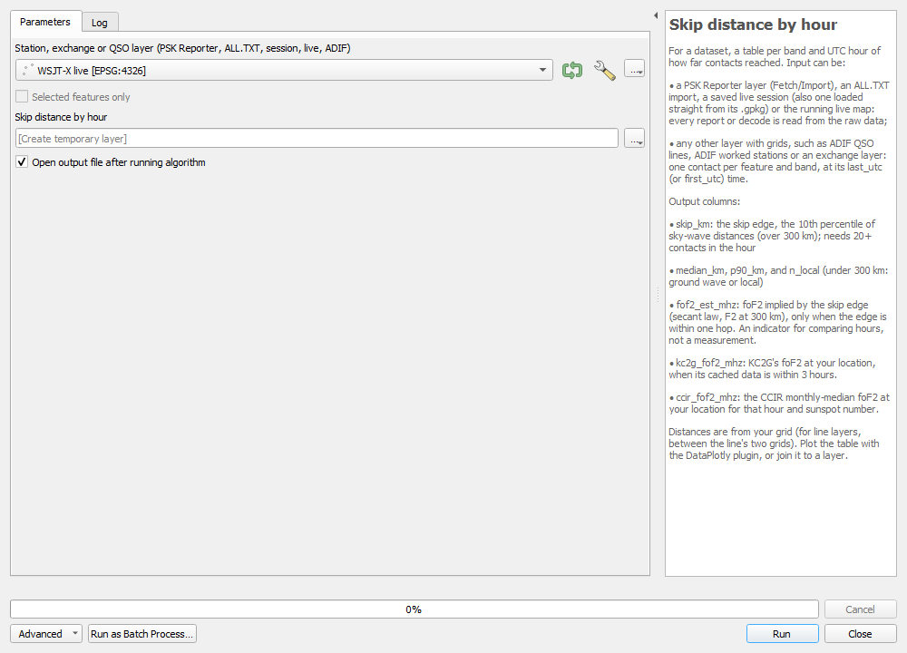
*The Skip distance by hour dialog.*

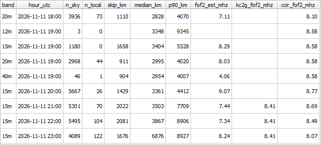
*Skip distance by hour for one day's ALL.TXT. The 12m hour has only 3 contacts, too few for a skip edge.*

#### Example

These are real values from one afternoon of 15m decodes in CN85 (Oregon) on 11 November 2026 (an ALL.TXT import; sunspot number R12 = 61). Local time is UTC − 8.

| hour_utc | n_sky | n_local | skip_km | median_km | fof2_est_mhz | ccir_fof2_mhz |
|---|---|---|---|---|---|---|
| 19:00 | 1,180 | 0 | 1,658 | 3,404 | 8.3 | 8.6 |
| 20:00 | 5,667 | 26 | 1,429 | 3,361 | 9.1 | 8.8 |
| 21:00 | 5,305 | 70 | 2,022 | 3,503 | 7.4 | 8.7 |
| 22:00 | 5,495 | 104 | 2,081 | 3,867 | 7.3 | 8.5 |
| 23:00 | 4,612 | 124 | 1,676 | 6,876 | 8.2 | 8.1 |
| 00:00 | 1,776 | 19 | 2,307 | 7,343 | 7.0 | 7.2 |

What this shows:

- **The skip edge** was shortest around local noon (20:00 UTC, 1,429 km) and moved out towards evening (2,307 km at 00:00 UTC, 4 p.m. local).
- **The estimate tracks the model** to within about 1.3 MHz, and on most hours much closer. It ran below the median at 21–22 UTC, which may mean the ionosphere was a little below its monthly median that afternoon, or may be noise in the estimate.
- **The median distance jumped** after 23:00 UTC, from about 3,900 km to 6,900 km. Long paths to Asia and the Pacific were opening as the nearer paths faded.

Checking one row by hand: 20:00 UTC, skip edge 1,429 km on 15m (21.074 MHz). A hop of 1,429 km off a 300 km layer meets it at an incidence where sec ≈ 2.32, so foF2 ≈ 21.074 ÷ 2.32 ≈ 9.1 MHz.

#### Reading the results

1. **Look at `skip_km` over the hours, band by band.** The shape matters more than any single value: a short skip at midday, growing towards evening, is a normal day.
2. **Compare bands in the same hour.** Higher bands have a longer skip edge. If 10m shows no skip edge at all while 15m does, 10m is closed or nearly so.
3. **Compare `fof2_est_mhz` with `ccir_fof2_mhz` and `kc2g_fof2_mhz`.** Within about 1 MHz is ordinary. An estimate well above the median for several hours suggests an enhanced day; well below suggests a depressed one, for example after a geomagnetic storm.
4. **Sudden jumps from one hour to the next** in `skip_km` can be real. Travelling ionospheric disturbances (TIDs) move the skip edge in and out over an hour or two. But first check `n_sky`: a thin hour is easily skewed.

#### Limits

- The foF2 estimate assumes a **fixed 300 km** layer. Each 50 km of error in that height changes the estimate by roughly 10–15%. No published work validates absolute foF2 from amateur spots; treat `fof2_est_mhz` as an indicator for comparing hours, not a measurement.
- It needs **20 or more** sky-wave contacts in the hour for a skip edge.
- The skip edge depends on **who is on the air**. If there are few stations at 1,000–2,000 km from you (over an ocean, say), the edge comes out too far.
- **Sporadic-E, scatter and ground-wave** contacts inside the skip zone pull the 10th percentile in; the percentile limits this but doesn't remove it.
- With **ADIF or station layers**, each QSO or station counts once, so the hours hold far fewer samples than a decode log.

#### Try this

- **Follow a day.** Run the live map for a full day on one band, then run this tool on the saved session and plot `skip_km` against `hour_utc` with DataPlotly.
- **Compare two days.** Run it on a quiet day and on a day after a geomagnetic storm (check the Kp index), and compare the skip edges.
- **Compare bands.** Switch between 20m and 15m every hour during an afternoon to see how the skip edge depends on frequency.
- **Use the timeline.** Select a few hours in the Activity timeline; it shows the skip edge per band for just those hours.

### 8.5 Predict paths with VOACAP

Runs **VOACAP** for every path in a line layer and compares its prediction with what was heard.

VOACAP is the standard HF prediction program, from NTIA/ITS (the US government's telecommunications lab). For a path, an hour, a month and a sunspot number it predicts the MUF, the mode (e.g. `2F2`: two F2 hops), the takeoff angle, the signal and noise, the SNR, and the **reliability (REL)**: on what share of the month's days the signal is strong enough. It includes absorption, noise, antennas and power, which *Check paths* does not.

The plugin does **not** include VOACAP. It runs your own copy.

#### Install VOACAP

- **Windows**: download the ITS HF propagation package (*itshfbc*) from the [ITS VOACAP page](https://its.ntia.gov/software/high-frequency/voacap-propagation-model/) and install it in the default folder, `C:\itshfbc`. Don't install it under *Program Files* (the program can't handle spaces in the path). It is free.
- **Linux / macOS**: install **voacapl** (Debian/Ubuntu: `sudo apt install voacapl`; or build it from [github.com/jawatson/voacapl](https://github.com/jawatson/voacapl)), then run `makeitshfbc` once to create `~/itshfbc`.

If you installed it somewhere else, enter the folder in the tool once; it is remembered.

The tool runs VOACAP in the background, on a hidden desktop on Windows, so no VOACAP windows appear. A run that takes too long is stopped. It uses its own input and output files in VOACAP's `run` folder and deletes them afterwards.

| Setting | Default | Notes |
|---|---|---|
| Paths | | A line layer from this plugin: exchanges, *Summarize exchanges* corridors, *Corridors over time*, or *Check paths* output. |
| VOACAP folder | the saved one, else `C:\itshfbc` | The *itshfbc* folder. Empty on Linux/macOS means `~/itshfbc`. |
| Month | from each path's date | Or a fixed month. |
| Sunspot number SSN | 0 = look it up | The 12-month smoothed number for the path's month, as for the CCIR model. For recent months, which have no smoothed value yet, the latest smoothed value is used. |
| Transmit power at each end (W) | 100 | Both stations are assumed to run this. |
| Transmit / receive antenna gain (dBi) | 0 / 0 | Both ends use VOACAP's isotrope: the same gain in every direction and at every angle. |
| Man-made noise at the receiver | Residential, −145 dBW | At 3 MHz, in 1 Hz (ITU-R P.372). Also *City* −140, *Rural* −150, *Quiet rural* −164. |
| Required SNR for REL | −21 dB | As WSJT-X reports it. VOACAP gets −21 + 34 = 13 dB in 1 Hz. |
| Label paths with the gap | off | |
| Paths with VOACAP | temporary layer | A copy of the input with new fields. |

**Which path, hour and frequency.** Each line runs from its first point (A) to its last (B), and is predicted both ways. The frequency is the band's FT8 frequency; a corridor on several bands uses the highest, as *Check paths* does (run it per band for clean comparisons). The hour is:

- *Corridors over time*: the frame's start hour;
- *Summarize exchanges* corridors: the middle of `first_utc`..`last_utc` (a note says when that spans more than 2 hours);
- exchanges: `first_utc`, to the nearest hour.

**Fixed settings.** Method 30 (VOACAP's recommended short/long path smoothing), CCIR foF2 maps, no sporadic-E, a minimum takeoff angle of 3° (VOACAP's own default), required reliability 90%. VOACAP covers 2–30 MHz, so 160m and 6m paths get a note and no prediction.

**New fields**:

| Field | Meaning |
|---|---|
| `voacap_ok` | 1 when VOACAP gave a prediction. |
| `voacap_note` | Why there is none, or a warning (several bands, a long time span, above VOACAP's MUF). |
| `voacap_utc`, `voacap_ssn`, `voacap_freq` | The hour, sunspot number and frequency (MHz) used. |
| `voacap_muf` | VOACAP's MUF for the path (MHz): the median over the month's days. |
| `voacap_mufday` | Share of the month's days the frequency is below the MUF. |
| `voacap_mode` | The most reliable mode, e.g. `1F2`, `2F2`, `1 E`. `F2F2` means VOACAP's long-path model (over about 7,000 km). |
| `voacap_tangle_deg` | Takeoff angle of that mode, degrees. |
| `voacap_rel` | **REL**: share of the month's days the SNR reaches the required SNR (0–1), mean of both directions. |
| `voacap_snr_hz` | VOACAP's SNR in 1 Hz (dB), mean of both directions. |
| `voacap_snr_db` | The same as WSJT-X would report it, in 2500 Hz: `voacap_snr_hz` − 34 dB. |
| `voacap_snr_ab_db`, `voacap_snr_ba_db` | Predicted SNR (2500 Hz) from A to B and from B to A. They differ by the noise at each receiver. |
| `voacap_sdbw` | Signal power at the receiver, dBW (A to B). |
| `obs_snr_db` | The observed SNR: the layer's `snr_db` (corridors), else the mean of the two reports (exchanges). |
| `snr_gap_db` | **Observed − predicted** (`obs_snr_db` − `voacap_snr_db`), dB. |
| `gap_a_to_b_db`, `gap_b_to_a_db` | The same per direction: `a_to_b_db` (or `b_hears_a`) and `b_to_a_db` (or `a_hears_b`) against the prediction that way. |

The log gives the median gap, the middle half of the gaps, and how many heard paths VOACAP rated below 10% REL.

**Style**: lines coloured by `snr_gap_db`, red where the path was heard weaker than predicted, blue where stronger, grey within 3 dB; dotted grey where there is no gap.

#### How to read snr_gap_db

- **Near 0**: the path was about as strong as VOACAP's monthly median.
- **Positive**: heard stronger than predicted. Common when the far station runs more power or a better antenna than assumed, or when the band was better than its median that day.
- **Negative**: heard weaker than predicted: less power, a poorer antenna, more noise, or a worse day.
- **Very large and positive (+50 dB or more)**: VOACAP puts the frequency above the MUF on most days (see `voacap_mufday` and the note), so its SNR is meaningless. These paths are the ones the monthly median says shouldn't be open; count them rather than averaging them.
- Look at the **median over many paths**, by distance or direction, not at single lines. One FT8 report fades by 10–20 dB from minute to minute.

#### Example

The corridors over time for 22:00–23:00 UTC on 11 November 2026 (one evening on 15m, cells = fields), with the defaults and SSN 88.6 (the latest smoothed value): VOACAP predicted all 168 corridors. For the 131 with reports, the median gap was −0.5 dB, with the middle half from −9 to +6 dB. Corridors under 5,000 km were heard weaker than predicted (median about −10 to −14 dB); corridors over 9,000 km were heard stronger (+5 dB). 12 of the 131 (9%) were paths VOACAP gave less than 10% REL.

#### Limits

- **Monthly medians.** VOACAP describes a typical day of the month at that sunspot number, not a given evening. Judge it over many days.
- **Assumed stations.** Both ends get the same power and an isotrope antenna. The real stations' power and antennas are unknown and differ a lot.
- **Censoring.** Only decoded signals are reported. Signals below about −21 dB are never seen, so observed medians are too optimistic, most on weak paths.
- **1 Hz vs 2500 Hz.** VOACAP's SNR is in 1 Hz; WSJT-X's in 2500 Hz. The tool subtracts 34 dB. FT8's real decode threshold also depends on the decoder.
- **Corridor centres.** Corridors run between cell centres, not the stations' squares, so distances and hops are approximate, most with field-sized cells.
- **Noise** is set for both ends. Real noise at each station varies by 10–20 dB.
- Results are cached by path, month, sunspot number, hour, frequency and settings, so a second run is fast.

#### Try this

- **Find the model's bias.** Run it on a week of corridors over time for one band, then plot `snr_gap_db` against `distance_km` with DataPlotly.
- **Compare with Check paths.** Run *Check paths* first, then this tool on its output: compare `muf_mhz` (basic MUF, ITU-R P.533) with `voacap_muf`.
- **Set your own station.** For exchanges with you at one end, set the power and antenna gain closer to your station and see how the gap moves.

## 9. Activity timeline

The top-level **Activity timeline** entry opens a panel under the map: a bar chart of activity per UTC hour that also filters the map.

1. Choose a dataset at the top. The list holds:
   - PSK Reporter station layers;
   - ALL.TXT imports;
   - saved live sessions, including a session `.gpkg` loaded into a new project;
   - **WSJT-X live map (running)**.
2. Bars show reports per hour:
   - PSK Reporter: blue = stations I heard, orange = stations that heard me.
   - WSJT-X: blue = decodes, orange = decodes addressed to me.

   Hover for counts.
3. **Drag** across the bars to choose hours. The map updates as you drag. The layers are rebuilt from only those reports, so counts, SNR, bands and first/last times all describe that window. The layer names show the window, e.g. *PSK Reporter stations · 11-24 08:00–20:00 UTC*.
4. Below the chart:
   - stations heard and heard-me, stations per band, and the farthest and strongest station in the window;
   - for logs, the skip edge per band.
5. **Double-click** or **All hours** chooses everything. **◀ ▶** move the window by its own length.


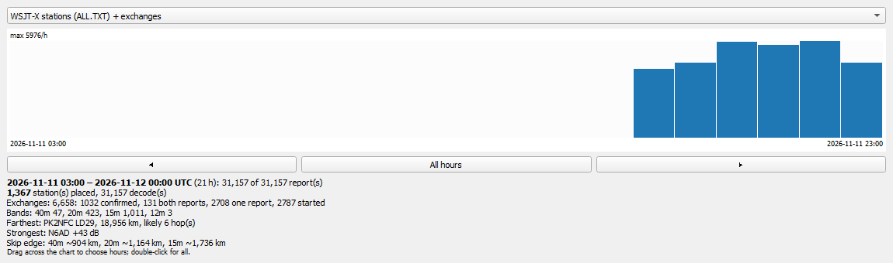
*The Activity timeline for one day's ALL.TXT import: decodes per hour, and the summary for the chosen hours.*

Notes:

- With the **running live map**, choosing hours holds live updates on the map; the listener keeps recording. *All hours* returns to live.
- Layers remember their source (folder, files or session file) and the chosen hours, so this works again after you reopen the project. New fetches or log entries are read in.
- The timeline replaces the layer's features. It refuses while a layer is being edited.
- ADIF layers are not listed.

## 10. Field reference

Times are UTC. Distances are great-circle distances between grid centres.

### 10.1 Station layers

From *Fetch/Import PSK Reporter*, the live map (*WSJT-X live*) and *Import ALL.TXT*.

| Field | Meaning |
|---|---|
| `call` | Callsign. |
| `grid` | Locator the marker is placed at (the most recent one heard). |
| `direction` | PSK Reporter: `heard` (I decoded them) or `heard_me` (they decoded me). WSJT-X: `heard`, or `worked` for logged QSOs. |
| `reports` | Number of reports or decodes. |
| `snr_best`, `snr_median`, `snr_last` | SNR in dB. On WSJT-X layers the median covers every decode of the station (in the chosen hours, for the timeline). |
| `bands`, `modes` | Comma-separated, low to high frequency. |
| `first_utc`, `last_utc` | First and last time heard. |
| `distance_km`, `bearing_deg` | From your grid. |
| `source` | `psk` or `live`. |
| `hops`, `takeoff_deg` | Fewest F2 hops (layer at 300 km) and the takeoff angle needed. Geometry only. |
| `called_me` | WSJT-X layers only: messages from this station addressed to you. |

### 10.2 Exchange layers

From the live map (*WSJT-X exchanges*) and *Import ALL.TXT*. A and B are the two stations.

| Field | Meaning |
|---|---|
| `id` | Exchange number. |
| `call_a`, `grid_a`, `call_b`, `grid_b` | The two stations. A sent the first message decoded in the exchange (often the one answering a CQ). |
| `band`, `mode` | |
| `stage` | `started`, `one report`, `both reports` or `confirmed`. |
| `a_hears_b` | The report A sent: how A hears B (dB). |
| `b_hears_a` | The report B sent: how B hears A (dB). |
| `me_hears_a`, `me_hears_b` | How *you* decoded A and B (dB). |
| `paths` | Label text, e.g. `N5ER→AH6U +07  AH6U→N5ER -04`. |
| `involves_me` | 1 if one side is you. |
| `logged` | 1 if you logged it in WSJT-X. |
| `messages`, `transcript` | Number of messages, and the messages themselves (repeats shown as ×n). |
| `first_utc`, `last_utc` | |
| `distance_km`, `hops`, `takeoff_deg` | As for stations. |
| `report_diff_db` | `b_hears_a − a_hears_b`: A's (power + receiver noise) minus B's. |
| `b_vs_me_db` | `b_hears_a − me_hears_a`: positive = B heard A better than you did. |
| `a_vs_me_db` | `a_hears_b − me_hears_b`: positive = A heard B better than you did. |

### 10.3 ADIF layers

**Worked stations (ADIF)**

| Field | Meaning |
|---|---|
| `call`, `grid` | The most recent (most precise) grid logged. |
| `direction` | Always `worked`. |
| `qsos` | Number of QSOs. |
| `bands`, `modes` | |
| `first_utc`, `last_utc` | First and last QSO. |
| `sent_best_db`, `rcvd_best_db` | Best report you sent and received (digital modes only). |
| `confirmed` | Number of confirmed QSOs. |
| `country` | As logged. |
| `distance_km`, `bearing_deg`, `hops`, `takeoff_deg` | From your grid. |
| `source` | `adif`. |

**QSOs (ADIF)**: all the [exchange fields](#102-exchange-layers), filled as follows:

- you are A: `a_hears_b` = report sent, `b_hears_a` = report received;
- `stage` is `confirmed` and `logged` is 1;
- `me_hears_a` and `me_hears_b` are empty;
- `transcript` holds the log comment.

Plus:

| Field | Meaning |
|---|---|
| `freq_mhz` | Logged frequency. |
| `rst_sent`, `rst_rcvd` | Reports as logged (text, any mode). |
| `confirmed` | `lotw`, `qsl`, `eqsl`, comma-separated. |
| `prop_mode` | ADIF propagation mode (e.g. `ES`, `SAT`, `EME`), if logged. |
| `country`, `comment` | |
| `source` | File(s) the QSO came from. |

### 10.4 Ionosphere layers

**Ionosondes**: `code`, `name`, `utc`, `age_min`, `fof2` (MHz), `hmf2` (km), `mufd` (MUF(3000), MHz), `md` (M(3000) factor), `foes` (sporadic-E critical frequency, MHz), `confidence` (KC2G's 0–100 rating), `source`.

**Ionosphere contours**: `level` (MHz or km).

**Paths with ionosphere** (from *Check paths*): the input layer's fields, plus `iono_utc`, `iono_source`, `iono_note`, `freq_mhz`, `f2_status`, `muf_mhz`, `fof2_mhz`, `hmf2_km`, `hops_iono`, `takeoff_iono`, `hops_muf` (P.533 hop count used for the MUF), `mode_guess` (*F2* / *Es* / *above basic MUF* / *no data*) and `bands_f2`. See [8.2](#82-check-paths-against-the-ionosphere). With *Also write the results into the input layer* ticked, the same fields are also added to the input layer.

**Reflection points** (from *Check paths*): `path_fid`, `calls`, `kind` (*hop* or *control point*), `n` (number along the path), `hops`, `fof2_mhz`, `hmf2_km`, `mufd_mhz`, `point_muf_mhz` (control points: the MUF judged there), `freq_mhz`, `f2_status`.

**Paths with VOACAP** (from *Predict paths with VOACAP*): the input layer's fields, plus `voacap_ok`, `voacap_note`, `voacap_utc`, `voacap_ssn`, `voacap_freq`, `voacap_muf`, `voacap_mufday`, `voacap_mode`, `voacap_tangle_deg`, `voacap_rel`, `voacap_snr_hz` (1 Hz), `voacap_snr_db` (2500 Hz), `voacap_snr_ab_db`, `voacap_snr_ba_db`, `voacap_sdbw`, `obs_snr_db`, `snr_gap_db`, `gap_a_to_b_db`, `gap_b_to_a_db`. See [8.5](#85-predict-paths-with-voacap).

**Sporadic-E candidates**: `path_fid`, `calls`, `grid_a`, `grid_b`, `band`, `freq_mhz`, `distance_km`, `takeoff_es`, `foes_min_mhz`, `f2_status`, `confidence` (*high*/*possible*), `cloud`, `last_utc`.

**Sporadic-E clouds**: `cloud`, `n_paths`, `bands`, `foes_max_mhz`, `high` (high-confidence candidates), `first_utc`, `last_utc`.

### 10.5 Analysis layers

**Station balance**

| Field | Meaning |
|---|---|
| `call`, `band`, `grid` | |
| `balance_db`, `std_err_db` | Balance and its standard error. |
| `n_two_way` | Two-way exchanges used. |
| `group_size` | Stations in its connected group. |
| `verdict` | `loud but deaf`, `balanced`, `good ears` or `uncertain`. |
| `n_censored`, `n_dropped` | Exchanges with a report at the floor or compressed; pairs left out. |
| `hears_vs_me_db`, `n_vs_me`, `n_vs_me_skipped` | Median "how they heard it minus how I did", its count, and skipped comparisons. |
| `is_me` | 1 for your own row. |
| `partners` | Distinct stations it exchanged with. |
| `median_km`, `max_km`, `farthest` | Median and largest distance to those partners, and the farthest one's call. |
| `bands` | Bands it was seen exchanging on. |
| `heard_db` | Median SNR others reported for its signal. |
| `hears_db` | Median SNR it reported for others. |

**Corridors over time** and **Active cells over time**: see [7.7](#77-propagation-over-time-time-slider).

**Exchange corridors** (see [7.6](#76-summarize-exchanges-by-grid-pair-corridors)):

| Field | Meaning |
|---|---|
| `cell_a`, `cell_b`, `band` | The two cells (alphabetical order) and band. |
| `exchanges`, `stations_a`, `stations_b` | Exchanges, and distinct callsigns at each end. |
| `a_to_b_db`, `n_a_to_b` | Median SNR of signals from A heard in B, and the number of reports. |
| `b_to_a_db`, `n_b_to_a` | The reverse. |
| `diff_db`, `n_two_way` | Median of (A→B minus B→A) over exchanges with both reports. |
| `snr_db` | Median of all reports, both ways (the line colour). |
| `distance_km` | Between the cell centres. |
| `first_utc`, `last_utc`, `hours_active` | Time span, and distinct UTC hours with an exchange. |
| `n_f2`, `n_es`, `n_above_muf` | From *Check paths* (`mode_guess`, or `f2_status`), when the input has them. |
| `calls_a`, `calls_b` | Callsigns at each end. |
| `label` | `exchanges×  A→B/B→A`, shown when zoomed in. |

**Antenna A/B** (direction, station and table outputs share these counts):

| Field | Meaning |
|---|---|
| `n_both` | Messages both receivers decoded (pairs). |
| `only_a`, `only_b` | Messages only A or only B decoded. |
| `median_db` | Median SNR(A) − SNR(B) over pairs. |
| `iqr_lo_db`, `iqr_hi_db` | Interquartile range (needs 4+ pairs). |
| `decode_adv` | `(only_a − only_b) / all decodes`. Positive favours A. |

With a reference pattern they also have:

| Field | Meaning |
|---|---|
| `abs_n` | Pairs with an absolute value (the station has a grid and the pattern covers its angle and frequency). |
| `abs_dbi` | Median estimated gain of the non-reference antenna, dBi. |
| `abs_lo_dbi`, `abs_hi_dbi` | 95% interval of that median, from fading scatter only (needs 6+ pairs). |
| `ref_dbi` | Median modelled gain of the reference antenna over the same pairs, dBi. |

- By direction adds `sector` and `bearing_deg`.
- By station adds:
  - `call`, `grid`, `distance_km`, `bearing_deg`;
  - `takeoff_deg`, `takeoff_min_deg`, `takeoff_max_deg`, `takeoff_300_deg`;
  - `hops`, `hmf2_km`;
  - `angle_method` (`KC2G`, `model` or `geometric`);
  - `prop_mode` (`F2`, `above basic MUF` or `Es`).
- The table adds `by` (`all`, `distance`, `takeoff`) and `bin`.
- Matched decodes (one row per decode, no counts): `utc` (slot start), `call`, `mhz`, `snr_a`, `snr_b` (empty if that receiver missed it), `diff_db`, `distance_km`, `bearing_deg`, `takeoff_deg`, `prop_mode`; with a reference pattern also `ref_gain_dbi` (the reference's modelled gain at that bearing and takeoff angle) and `abs_gain_dbi` (the other antenna's estimated gain; empty for single decodes).

**Skip distance by hour**: see [8.4](#84-skip-distance-by-hour).

### 10.6 Research dataset

From *Export research dataset* (a CSV file, not a layer). Path fields are empty unless both grids are known. Details in [research-export-schema.md](research-export-schema.md).

| Field | Meaning |
|---|---|
| `schema_version`, `source` | `1.1` (`1.0` before 0.15.0); `alltxt`. |
| `observer` | Your callsign: whose log the row came from. |
| `time_utc` | When the message was sent, e.g. `2026-11-11T21:00:30Z`. |
| `band`, `freq_mhz`, `mode` | `freq_mhz` is the dial frequency plus the audio offset. |
| `report_kind` | `exchange_report`, `my_decode` or `not_decoded` (see [7.8](#78-export-research-dataset)). |
| `exchange_id` | Links rows of one exchange. Empty for CQs. |
| `tx_call`, `tx_grid` | The station transmitting. |
| `rx_call`, `rx_grid` | The station receiving: the one that measured the SNR. |
| `snr_db` | SNR in dB. Empty for `not_decoded`. |
| `censored` | 1 if `snr_db` is at or below the decode floor; always 1 for `not_decoded`. |
| `n_decoded` | Times this report was decoded in the exchange (1 for your decodes, 0 for `not_decoded`). |
| `grid_precision` | Characters in the coarser grid (4 or 6). |
| `distance_km`, `bearing_deg` | From tx to rx. |
| `n_min_hops` | Fewest F2 hops (layer at 300 km). |
| `cp1_lat`, `cp1_lon`, `cp2_lat`, `cp2_lon` | Control points: the midpoint up to 2000 km; else 1000 km from tx (cp1) and from rx (cp2). |
| `cp1_sza_deg`, `cp2_sza_deg` | Solar zenith angle at each control point. |
| `day_night` | `day` (zenith below 90°), `twilight` (90–108°), `night` (108° or more), or `mixed` (the two control points differ). |
| `muf_basic_mhz` | Basic MUF of the path at that time from the CCIR monthly-median model, as *Check paths* computes it. Added in 1.1, like the three below; they come after all the 1.0 fields. |
| `f_over_muf` | `freq_mhz` / `muf_basic_mhz`. Over 1: above the basic MUF. |
| `es_candidate` | 1 if *Find sporadic-E paths* would call it high confidence (12m–2m at 500–2,300 km; on 12m/10m above the basic MUF), 0 if not, empty if it can't be told. |
| `foes_min_mhz` | For Es candidates: the lowest Es critical frequency that returns `freq_mhz` at that distance. |

## 11. Data files, caches and settings

The plugin keeps downloads in your QGIS profile folder. On Windows this is `%APPDATA%\QGIS\QGIS3\profiles\default\`. In QGIS, *Settings → User Profiles → Open Active Profile Folder* opens it.

| Folder | Contents |
|---|---|
| `maidenhead_mapper\kc2g\` | KC2G cache: `stations.json`, `mufd.geojson`, `fof2.geojson`, `hmf2.geojson`, `essn.json`, `meta.json`. Refreshed at most every 15 minutes. |
| `maidenhead_mapper\alltxt_index\` | One small JSON index per ALL.TXT file used in *Propagation over time*: time span, bands, decodes per hour and where each day starts. Extended when the file grows; rebuilt if it was replaced. |
| `maidenhead_mapper\voacap\` | `predictions.json`: VOACAP results by path, month, sunspot number, hour, frequency and settings. `last_failed.dat`/`.out`: the input and output of the last failed VOACAP run, for troubleshooting. |
| `maidenhead_mapper\ccir\` | CCIR model coefficients `ccir11.asc`–`ccir22.asc` (~0.5 MB, downloaded once), and SILSO sunspot numbers `smoothed.csv` and `monthly.csv` (refreshed weekly). |

Your own data stays where you put it:

- PSK Reporter fetches in the folder you chose;
- live sessions in the session folder;
- outputs wherever you saved them.

**Settings** are stored in QGIS's settings under `maidenhead_mapper/`:

- `mycall`, `mygrid`: your callsign and grid;
- `psk_folder`: the last PSK Reporter folder;
- `live/…`: the live panel's mode, address, port, fade, save and folder;
- `propagation_files`: the ALL.TXT files last used in *Propagation over time*;
- `voacap_dir`: the VOACAP (*itshfbc*) folder, when it isn't `C:\itshfbc`.

Deleting the cache folders is safe; the data is downloaded again when needed.

## 12. Troubleshooting

**Predict paths with VOACAP: "VOACAP was not found"**
Install VOACAP (see [8.5](#85-predict-paths-with-voacap)). On Windows the tool looks for `bin_win\voacapw.exe` and a `run` folder under `C:\itshfbc` or the folder you enter. On Linux/macOS, `voacapl` must be on the PATH and `~/itshfbc` must exist (run `makeitshfbc`).

**Predict paths with VOACAP: "VOACAP stopped without finishing its output"**
The input and output of the failed run are in `maidenhead_mapper\voacap\` in your QGIS profile (`last_failed.dat`, `last_failed.out`). Check that the `run` folder in *itshfbc* is writable.

**Live map: "Could not listen on 127.0.0.1:2237"**
Another program (JTAlert, GridTracker, a logger) owns the port in unicast mode. Switch everything to multicast `239.255.0.1:2237` (see [7.1](#71-wsjt-x-live-map)).

**Live map is listening but shows "No WSJT-X heard yet"**
- Check WSJT-X's *UDP Server* address and port match the panel.
- Check the right *Outgoing interfaces* are ticked in WSJT-X (include loopback).
- A firewall may block UDP for QGIS.

**A station never appears on the map**
It hasn't sent a grid yet. FT8 sends grids only in CQs and when answering a call. The panel counts these as *waiting for a grid*; they appear once a grid is decoded. PSK Reporter reports without a locator are counted in the import log.

**"Feature (…) has invalid geometry" when running Check paths, Find sporadic-E paths or Skip distance**
On versions before 0.8.2, exchanges between two stations in the same grid square could be drawn as zero-length lines, which QGIS rejects. Either:
- update the plugin and restart QGIS (0.8.2 and later ignore geometry when reading paths); or
- click the wrench icon next to the input layer and set **Invalid features filtering** to **Do not filter**.

**"The layer needs grid_a/grid_b (exchanges) or grid (stations)"**
The input isn't a station or exchange layer: for example *Ionosondes* or a contour layer. Choose a layer from the PSK Reporter, WSJT-X or ADIF tools.

**"Enter My grid: station layers are paths from you"**
Station-layer paths start at your grid. Enter it in *My grid*.

**Skip distance: "This layer has no raw data to read and no usable paths"**
The layer has no grid fields (for example the Maidenhead grid or the ionosonde layer). Use a PSK Reporter, ALL.TXT, session, live or ADIF layer, or any layer with `grid_a`/`grid_b` or `grid` fields plus a band and a time.

**Skip distance: "This live map is no longer running and wasn't saved"**
An unsaved live map's decodes are kept only while it runs. Tick *Save session to a GeoPackage* before pressing Start next time.

**The Activity timeline doesn't list my layer**
It lists layers made by the PSK Reporter tools, *Import ALL.TXT* and the live map, and session GeoPackages loaded from the `.gpkg` (recognised by their `stations`, `exchanges` and `log` tables). Load the `stations` or `exchanges` table, not `log`. ADIF layers are not listed.

**Propagation over time: "No exchanges with both grids known in this window"**
Nothing in the chosen hours could be placed: no exchanges, or the stations never sent grids. Pick a busier window on the chart (taller bars), or try *All bands*.

**Propagation over time: the map shows every hour at once, or nothing**
- *Every hour at once*: the Temporal Controller is off (its first button). Choose the *Animated* mode (the ▶ icon in its toolbar).
- *Nothing*: the slider is outside the built window, or in an hour without exchanges. Press the "go to start" button, or set the range from the layer (the refresh button next to the range).
- To keep earlier frames visible, tick *Cumulative range* in the Temporal Controller's settings.

**Propagation over time: Index finds no decodes**
The file isn't a WSJT-X 2.1+ `ALL.TXT` (lines like `261111_210000    14.074 Rx FT8 ...`). Older formats aren't read.

**PSK Reporter: "wait N min"**
PSK Reporter allows one query per 5 minutes. Wait, or map what you already have with *Import PSK Reporter reports*.

**Export research dataset: "Enter My callsign"**
Your decodes are rows received at your station, so the tool needs your callsign. Enter it, or set it once in another tool (e.g. *Import PSK Reporter reports*), which stores it.

**Export research dataset: muf_basic_mhz is empty**
The log says why (*No MUF for N row(s): …*). Usually there is no sunspot number for that month yet: enter one under *Sunspot number R12*. The first run also needs internet for the CCIR coefficients.

**Export research dataset: many rows have empty distance and day_night**
Those stations never sent a grid in the read period, or *My grid* is empty (your decodes then have no path). Set *My grid*, or start *From* a little earlier.

**Check paths says "no data" for everything**
For KC2G, the paths must be within the time limit (3 hours by default) of KC2G's data. Choose *Auto* or *CCIR model only* for older paths. The first CCIR run needs internet to download the coefficients.

## 13. Credits and licences

- **Plugin**: GNU General Public License v3 or later (see `LICENSE`).
- **KC2G** ([prop.kc2g.com](https://prop.kc2g.com)): ionosonde data and MUF/foF2/hmF2 maps, built from GIRO and INGV ionosondes over IRI-2020. A volunteer service; please use it gently.
- **CCIR coefficients**: the ITU-R P.1239 (CCIR) foF2 and M(3000) coefficient files as distributed with IRI, downloaded from the MIT-licensed [space-physics/iri2016](https://github.com/space-physics/iri2016) repository (pinned to one commit).
- **VOACAP**: by NTIA/ITS, not included; the plugin runs your installed copy (Windows *itshfbc*, or J. A. Watson's [voacapl](https://github.com/jawatson/voacapl) port). The deck and output formats follow voacapl's source and sample files; two sample files from voacapl (public domain / CC0) are used in the plugin's tests.
- **Sunspot numbers**: WDC-SILSO, Royal Observatory of Belgium, Brussels. Licensed CC BY-NC 4.0 (non-commercial use).
- **Methods**: ITU-R P.533-14 (HF path MUF), ITU-R P.1239 (ionospheric reference characteristics). The station-balance method follows DK3BA's (2024) analysis of FT8 report statistics.
- **Modified dip latitude**: a grid derived from the IGRF magnetic field model, shipped with the plugin.
- **Band colours**: close to the schemes used by PSK Reporter and GridTracker.
